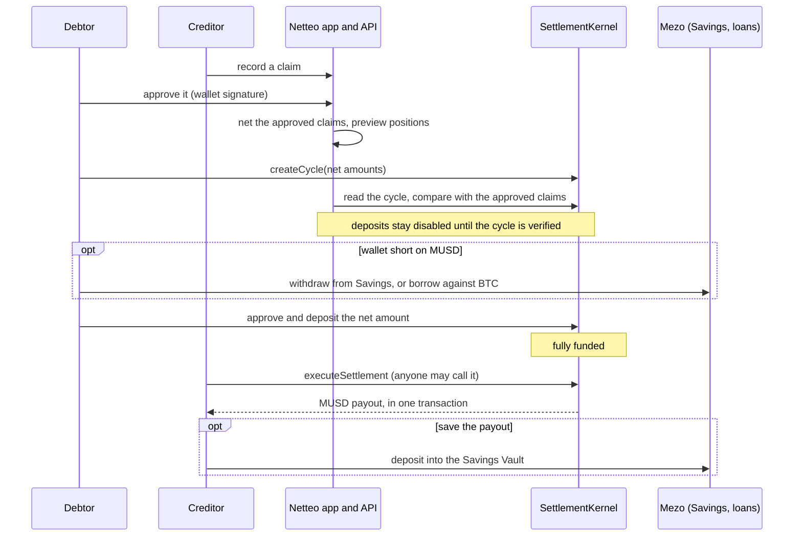

# Netteo

**Settle with your Bitcoin, not by selling it.**

Netteo cancels out what a group owes each other, settles only the net amount in MUSD on Mezo Mainnet, and lets each debtor cover their share from the MUSD Savings Vault or a loan against Bitcoin they already hold.

[](https://explorer.mezo.org)
[](https://netteo-six.vercel.app)
[](https://app.akindo.io/wave-hacks/OVOO0gdrVU8379D10)
[](contracts/)
[](https://nextjs.org)

## Contents

- [Try it](#try-it)
- [The problem and the idea](#the-problem-and-the-idea)
- [Features](#features)
- [How Netteo uses Mezo](#how-netteo-uses-mezo)
- [On-chain evidence](#on-chain-evidence)
- [How a settlement works](#how-a-settlement-works)
- [Architecture](#architecture)
- [Security model](#security-model)
- [Known limitations](#known-limitations)
- [Getting started](#getting-started)
- [Testing](#testing)
- [Deployment](#deployment)
- [Project structure](#project-structure)
- [Documentation](#documentation)
- [License](#license)
- [AI disclosure](#ai-disclosure)

---

## Try it

| | |
|---|---|
| **Live app** | https://netteo-six.vercel.app |
| **Funding Check** (no wallet needed) | https://netteo-six.vercel.app/funding: pick a real Bitcoin-backed loan on Mezo and see what it could fund |
| **A real settlement** (no wallet needed) | [MUSD cycle](https://netteo-six.vercel.app/cycles/0x7ff4cbf39083469093a005be46bf698bd2d36b2d0c343374d4fecb224d32d420) and its [receipt](https://netteo-six.vercel.app/cycles/0x7ff4cbf39083469093a005be46bf698bd2d36b2d0c343374d4fecb224d32d420/audit), read straight from the contract |
| **Documentation** | https://netteo-six.vercel.app/docs |

No wallet? Switch to **Demo** in the header to run the full flow on sample data. Demo mode is clearly labelled and never touches the chain.

---

## The problem and the idea

A working group, agency or DAO often owes itself money in loops. Paying every claim separately means every debtor must find the full amount first, even though most of it cancels out.

| | Pay each claim separately | Netted by Netteo |
|---|---|---|
| A owes B 100, B owes C 80, C owes A 20 | 200 to find up front, 3 transfers | **80 deposited**, one payout transaction |

Less MUSD to find means less to sell or borrow. That matters most to people who hold their wealth in Bitcoin on Mezo.

> The saving depends on how circular a group's debts are. A group with no loops saves nothing, and the saving is in what must be deposited, not a guaranteed saving in fees.

---

## Features

- **Claims with signed approval.** Each debtor approves or disputes a claim with a wallet signature. Disputed claims are never netted.
- **Share links** that open a claim directly for the debtor.
- **Net preview** before anything touches the chain, then a settlement cycle on Mezo.
- **Funding without selling Bitcoin.** If a wallet is short on MUSD, withdraw from the **MUSD Savings Vault** or **borrow against an existing Bitcoin loan**. Netteo shows the fee, the interest, the collateral ratio and the liquidation price, and refuses to build a borrow that leaves the loan under 150%.
- **Save a payout.** After settlement, deposit the MUSD into the Savings Vault in one step.
- **Read-only Funding Check** for any wallet.
- **Receipts and CSV export** for every settlement, with explorer links. Receipts load from the contract even without a wallet or a local record.
- **Multi-token.** Settle in MUSD, mUSDC or mUSDT; one token per cycle, never mixed.

---

## How Netteo uses Mezo

| Mezo component | What Netteo does with it | How it is verified |
|---|---|---|
| **MUSD** (and mUSDC, mUSDT) | The settlement asset. One settlement kernel per token. | Real cycles on mainnet in MUSD and mUSDC |
| **MUSD Savings Vault** | Withdraw to fund a deposit, deposit a payout, claim yield | A real mainnet round trip (3 transactions) |
| **BorrowerOperations, TroveManager, HintHelpers, SortedTroves, PriceFeed** | Read a Bitcoin-backed loan and borrow the missing MUSD against it, with placement hints | Live mainnet reads; the borrow itself on a mainnet fork using the real contracts |
| **Mezo RPC and explorer** | Three RPC providers with automatic failover; every transaction links to the explorer | Always on |

Protocol parameters (the 0.1% issuance fee, 1% interest, 110% minimum ratio, 1,800 MUSD minimum loan) are **read from the chain**, never hard-coded.

---

## On-chain evidence

Everything below ran on Mezo Mainnet. `src/lib/chain/deployments.test.ts` re-checks every address, token binding, amount and transaction against the live chain.

| What | Result | Transactions |
|---|---|---|
| **v2 settlement, MUSD** | A deposited 0.32 MUSD, B received 0.08, C received 0.24. Gross claims 0.80. Kernel left at 0. | [create](https://explorer.mezo.org/tx/0xdaceb9e491895ea5eb09caeb7c537f7d87b4318803c53cb1ee2ee47da122955e) · [deposit](https://explorer.mezo.org/tx/0x0340fd70a4e04fcf6d3b0787e5f8726cc99176b45e5f412610213bc8d3b457ce) · [execute](https://explorer.mezo.org/tx/0x9795326bd5fb24acd1fbbb869027bbdad231be58e9be98ab85d89226f3971f45) |
| **v2 settlement, mUSDC** (6 decimals) | A deposited 0.004 mUSDC, B received 0.001, C received 0.003. Gross 0.01. Kernel left at 0. | [create](https://explorer.mezo.org/tx/0xa995a681dd58fde22b3bee90820c0611ed498a55d7ef1d833ef5641c4e5cbcb8) · [deposit](https://explorer.mezo.org/tx/0xb64b8fce7afa90a3cbd31d196b452f09b31934afbfa5d7f3fd2d7434423b019d) · [execute](https://explorer.mezo.org/tx/0xc1b2477636805830b8e661467f711f18f173e6527c42ffecd4b6bfd112c5547e) |
| **v1 settlement** (superseded) | A deposited 0.40 MUSD, B received 0.10, C received 0.30. Gross 1.00. | [create](https://explorer.mezo.org/tx/0xe2f2fb78315deb75edb117e84a401a51a057ed0b6c6d990c7f20a8688e2f7dce) · [deposit](https://explorer.mezo.org/tx/0x902a4912efc9fd508886f7ff767b294468312ed99fcaadc49dc597cc1a4a35b1) · [execute](https://explorer.mezo.org/tx/0x4093d636a434ae210740be916a0c10e927b40e6de9b8f1b24bdc7b7f159c3c2f) |
| **Savings Vault round trip** | 0.01 MUSD in, 0.01 MUSD out, every wei returned | [approve](https://explorer.mezo.org/tx/0x465b2b8693049f1fd96eab277a7c5f57d9c00f1fe67967c4887ae0ee6b5cd4a4) · [deposit](https://explorer.mezo.org/tx/0x582f2266b8408fb3126ef58e7f08bbe7021d8a0b006ab697685ea1c30d506091) · [withdraw](https://explorer.mezo.org/tx/0x2006cdd63fde64e2b0778522569431305dac09c1627a81d038e9bb4e9d9ba15c) |

Verify a settlement yourself with [Foundry](https://book.getfoundry.sh):

```bash
RPC=https://mezo-mainnet.boar.network
K=0x427Ff00c792252cC364Cb3240Dc26E6e7872340e   # MUSD kernel (v2)

# state 3 = Completed; also prints gross, net, funded and distributed totals
cast call $K "getCycle(bytes32)(bytes32,string,uint256,uint256,uint256,uint256,uint256,uint256,uint8,address)" \
  0x7ff4cbf39083469093a005be46bf698bd2d36b2d0c343374d4fecb224d32d420 --rpc-url $RPC
```

### Contracts (v2, current)

| Contract | Address |
|---|---|
| SettlementKernelFactory | [`0x95e35305d466dF41EF35E02AA53F1e90Db759a45`](https://explorer.mezo.org/address/0x95e35305d466dF41EF35E02AA53F1e90Db759a45) |
| SettlementKernel, MUSD | [`0x427Ff00c792252cC364Cb3240Dc26E6e7872340e`](https://explorer.mezo.org/address/0x427Ff00c792252cC364Cb3240Dc26E6e7872340e) |
| SettlementKernel, mUSDC | [`0xE229B3a2020FC19331E8A3e9662a2508fFF78020`](https://explorer.mezo.org/address/0xE229B3a2020FC19331E8A3e9662a2508fFF78020) |
| SettlementKernel, mUSDT | [`0xFecBE8a962F5C2628E877AA4C0C90C399549f18f`](https://explorer.mezo.org/address/0xFecBE8a962F5C2628E877AA4C0C90C399549f18f) |

v2 fixes three issues found in a review of v1: funds that could be locked in a stuck cycle, fee-on-transfer tokens, and cycle-id squatting. v1 holds no funds and the app does not use it. Fees, block numbers and what each deployment proves are in [DEPLOYMENTS.md](DEPLOYMENTS.md).

---

## How a settlement works



If a cycle is not fully funded by its deadline, each depositor reclaims exactly what they deposited with `claimRefund`.

---

## Architecture

| Layer | Technology | Responsibility |
|---|---|---|
| Contracts | Solidity 0.8.24, Foundry | `SettlementKernel` holds deposits until a cycle is fully funded, then pays every creditor atomically. One kernel per token, created by `SettlementKernelFactory`. No owner, admin or pause. |
| Web app | Next.js 16 (App Router), React 19, TypeScript | Claims, groups, netting preview, cycle execution, receipts, in-app docs |
| Wallet and chain | wagmi 3, viem 2, RainbowKit | Wallet connection, signatures, contract reads and writes, RPC failover |
| API | Next.js route handlers | Wallet sessions, signed actions, nonce replay protection, rate limiting, cycle verification |
| Data | Supabase Postgres with row-level security | Private claim ledger (service role only) and public chain projections written by an event indexer |
| Hosting | Vercel | Deploys from `main` |

### State machines

Each lifecycle is a small, pure, tested module shared by the API, the UI and the tests:

| Lifecycle | Module |
|---|---|
| Payment claim (proposed → accepted, disputed or withdrawn; then frozen and settled by a cycle) | [`src/lib/obligations/machine.ts`](src/lib/obligations/machine.ts) |
| Settlement cycle (what each on-chain phase allows) | [`src/features/settlement-cycles/machine.ts`](src/features/settlement-cycles/machine.ts) |
| Wallet transaction (idle → wallet → confirming → success or error) | [`src/lib/mezo/txMachine.ts`](src/lib/mezo/txMachine.ts) |
| List screen (loading, error, ready, needs-wallet, empty) | [`src/lib/screenState.ts`](src/lib/screenState.ts) |

API refusals on claim actions return a machine-readable `code` (`wrong_state`, `not_debtor`, `not_party`) alongside the human-readable `error`.

---

## Security model

- **No privileged keys in the contract.** No owner, admin or pause; funds leave only through settlement or refund.
- **Signed actions.** Every claim action is signed by the right wallet. Signatures expire after five minutes and each nonce is used once, so replays are refused.
- **Private data stays private.** Private tables have row-level security and no public policy; all access goes through an API that requires a signed wallet session.
- **Cycle verification before deposits.** Anyone can create a cycle that names you as a debtor, so the server recomputes the netting and compares it with the chain before deposits are enabled.
- **Borrowing safety floor.** Netteo never builds a borrow under 150% collateral; Mezo liquidates at 110%.
- **Abuse protection.** The API is rate limited and returns plain-language errors, never stack traces.

---

## Known limitations

- **The contracts have not been independently audited.**
- **Wallet flows were verified with a scripted test wallet on a fork,** driven through the real UI. A browser wallet extension such as MetaMask has not yet been used end to end.
- **Borrowing against Bitcoin has not been executed on mainnet by the team.** A new Mezo loan needs at least 1,800 MUSD of debt. The borrow is verified against the real Mezo contracts on a mainnet fork, and the reads are live. Netteo only borrows against an existing loan.
- **MEZO and Mezo Passport are not integrated.** Passport pins React 18 and wagmi 2; this app uses React 19 and wagmi 3. MEZO needs testing with real funds first.
- **Claim approvals live in the private database,** not on-chain. The server checks a cycle against them before deposits open, but the contract cannot.
- **Not yet tested with real groups.** The target users are a hypothesis.
- **The rate limiter counts per server instance,** so the effective limit is per instance.

---

## Getting started

Requirements: Node.js 22, [Foundry](https://book.getfoundry.sh/getting-started/installation), and a [Supabase](https://supabase.com) project.

```bash
git clone https://github.com/syther069/netteo.git
cd netteo
npm install
cp .env.example .env.local
```

1. In Supabase, run [`src/lib/db/schema.sql`](src/lib/db/schema.sql) in the SQL editor.
2. In `.env.local`, set `NEXT_PUBLIC_SUPABASE_URL`, `NEXT_PUBLIC_SUPABASE_ANON_KEY`, `SUPABASE_SERVICE_ROLE_KEY` and `SESSION_SECRET` (the file explains each). The Mezo contract addresses are prefilled with the public v2 deployment.
3. Start the app:

```bash
npm run dev    # http://localhost:3000
```

### Try the wallet flows without real funds

The [wallet playground](scripts/wallet-playground/README.md) creates a funded test wallet (with a Mezo loan and Savings) on a local fork of Mezo Mainnet, so you can click through connecting, withdrawing from Savings, borrowing and saving a payout against Mezo's real contracts.

---

## Testing

```bash
npm run typecheck   # TypeScript
npm test            # TypeScript unit and integration tests
forge test          # Solidity tests
npm run build       # production build
```

Some TypeScript tests read the live Mezo chain so they catch a wrong address or documentation that drifted from reality: `deployments.test.ts`, `protocol.test.ts` and `tokens.test.ts`. Set `SKIP_CHAIN_PROBE=1` to run offline.

The Mezo borrowing and Savings Vault test runs the real Mezo contracts on a local fork. Nothing is sent to the real chain:

```bash
anvil --fork-url https://mezo-mainnet.boar.network --port 8547
MEZO_MAINNET_FORK_URL=http://127.0.0.1:8547 npx tsx src/lib/mezo/fork.test.ts
```

The kernel is also tested against the real MUSD, mUSDC and mUSDT contract code:

```bash
MEZO_MAINNET_FORK_URL=https://mezo-mainnet.boar.network forge test --match-contract Fork
```

CI runs the type check, the TypeScript tests, the Solidity tests and the build on every push.

---

## Deployment

### Contracts

Deployment is irreversible and costs real BTC for gas (v2 cost 0.0000093827 BTC). Keep the deployer key out of plain-text files by importing it into Foundry's encrypted keystore:

```bash
cast wallet import deployer --interactive
```

```bash
# 1. Dry run: checks every token's code, decimals and symbol on-chain; deploys nothing
CONFIRM_MAINNET_DEPLOY=true forge script script/Deploy.s.sol:Deploy \
  --rpc-url https://mezo-mainnet.boar.network --account deployer --sender <your-address>

# 2. Broadcast: deploys the factory, then one kernel each for MUSD, mUSDC and mUSDT
CONFIRM_MAINNET_DEPLOY=true forge script script/Deploy.s.sol:Deploy \
  --rpc-url https://mezo-mainnet.boar.network --account deployer --sender <your-address> --broadcast
```

The script prints the `NEXT_PUBLIC_SETTLEMENT_KERNEL_*` values to use. `script/AcceptanceTest.s.sol` runs a real three-party cycle (`ACCEPTANCE_PERCENT` scales it down; mainnet runs need `CONFIRM_MAINNET_ACCEPTANCE=true`). Rehearse on a fork first with `anvil --fork-url ...`.

### Web app

| Variable | Purpose |
|---|---|
| `SUPABASE_SERVICE_ROLE_KEY` | Server only. The API cannot reach the database without it. |
| `SESSION_SECRET` | At least 32 random characters. Without it, sign-in fails closed. |
| `NEXT_PUBLIC_SUPABASE_URL`, `NEXT_PUBLIC_SUPABASE_ANON_KEY` | Public. The anon key can only read chain-derived tables. |
| `NEXT_PUBLIC_SETTLEMENT_KERNEL_FACTORY_ADDRESS`, `..._MUSD`, `..._MUSDC`, `..._MUSDT`, `..._DEPLOY_BLOCK` | The deployment addresses above. |
| `INDEXER_CRON_SECRET` (optional) | Protects `/api/indexer` for an external scheduler. |

**Upgrading an existing database:** deploy the new app first, then back up and run `src/lib/db/migrations/002` to `004` in order. Running `003` first locks out an older app. A fresh database only needs `schema.sql`. Indexing needs no scheduler: loading cycles queues a throttled run.

---

## Project structure

| Path | Contents |
|---|---|
| `contracts/` | `SettlementKernel` and `SettlementKernelFactory` |
| `test/contracts/` | Foundry tests, including real-token fork tests |
| `script/` | Deploy and acceptance scripts with mainnet confirmation guards |
| `src/app/` | Next.js pages and API routes (`/api/session`, `groups`, `obligations`, `cycles`, `indexer`) |
| `src/features/` | Product areas: claims, groups, settlements, funding, receipts, docs |
| `src/lib/mezo/` | Mezo integration: borrowing math, chain reads, Savings Vault, transaction lifecycle |
| `src/lib/chain/` | Token registry, deployments, RPC fallback, contract hooks |
| `src/lib/api/`, `src/lib/auth/` | Request handling, wallet sessions, signatures, rate limiting |
| `src/lib/db/` | Database schema and migrations |
| `scripts/` | Brand asset generation and the wallet playground |

---

## Documentation

- **In-app documentation:** https://netteo-six.vercel.app/docs (architecture, state machines, security model, contract API, Mezo integration)
- [DEPLOYMENTS.md](DEPLOYMENTS.md): addresses, transactions, fees and what each deployment proves
- [Wallet playground](scripts/wallet-playground/README.md): test the wallet flows on a local fork

---

## License

No license has been granted yet. Until one is added, the code is under default copyright and may not be reused without permission.

---

## AI disclosure

This project was built with the help of AI coding assistants, including Anthropic's Claude through Claude Code. They were used to write and refactor code, write tests, review for bugs and security issues, and draft documentation, including this README.

The team chose the product direction and the Mezo integrations, reviewed the changes, and approved and signed every mainnet transaction. AI output was not trusted on its own: the contracts are covered by Foundry tests, the app by TypeScript tests and a production build, and every on-chain claim in this README is re-checked against Mezo Mainnet by `src/lib/chain/deployments.test.ts`. The contracts have not been independently audited.
