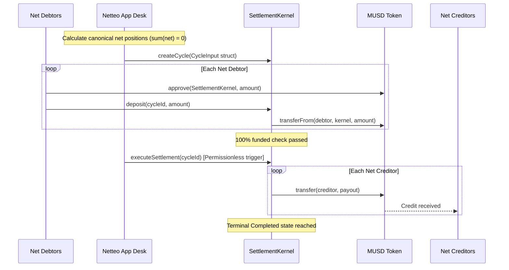

# Netteo — Multilateral Obligation Netting & MUSD Settlement on Mezo

> **Many obligations. One net settlement.**  
> Reconcile mutual payment obligations across Web3 service collectives and DAO working groups, calculate deterministic zero-sum net positions, and settle atomically in canonical MUSD on Mezo Mainnet.

[](https://explorer.mezo.org)
[](https://netteo-six.vercel.app)
[](https://docs.soliditylang.org)
[](https://nextjs.org)
[](https://www.typescriptlang.org)

**Live Production Application:** [https://netteo-six.vercel.app](https://netteo-six.vercel.app)  
**Verified Release & Demo Checklist:** [walkthrough.md](walkthrough.md)

---

## Mezo integration

Netteo settles in canonical MUSD and plugs into Mezo's own products so a debtor can fund a deposit without selling Bitcoin. All of it lives in [`src/lib/mezo`](src/lib/mezo) and is read live from Mezo Mainnet.

| Mezo component | What Netteo does | Verified |
|---|---|---|
| MUSD, mUSDC, mUSDT | Settlement assets, one kernel per token | Real cycles on mainnet ([DEPLOYMENTS.md](DEPLOYMENTS.md)) |
| MUSD Savings Vault (sMUSD) | Withdraw to fund a deposit, save a payout, claim yield | **Real mainnet round trip** (3 transactions) |
| BorrowerOperations, TroveManager, HintHelpers, SortedTroves, PriceFeed | Borrow the missing amount against an existing Bitcoin loan, behind a 150% safety floor (Mezo liquidates at 110%) | Real contracts on a mainnet fork (`fork.test.ts`); live reads in `protocol.test.ts` |

Try it without a wallet at `/funding`: pick one of the real Bitcoin-backed loans on Mezo and see what it could fund. Submission answers for the Mezo Buildathon are in [docs/SUBMISSION.md](docs/SUBMISSION.md).

Borrowing is verified on a fork, not executed on mainnet by the team: a new Mezo loan needs at least 1,800 MUSD of debt. MEZO and Mezo Passport are not integrated.

---

## Try it in two minutes

1. **See real evidence first.** The landing page's **Evidence** section links to two real three-party cycles settled in MUSD on Mezo Mainnet, with explorer links for each transaction. The same hashes are in [DEPLOYMENTS.md](DEPLOYMENTS.md).
2. **No wallet?** Open the app and switch to **Demo** (the header toggle, or the menu on a phone). Demo runs the three-party example on sample data and is labelled as a sandbox; nothing in it is on-chain.
3. **With a wallet** (Mezo Mainnet, a little BTC for gas, some MUSD): create a group with the other participants, propose claims, have each debtor accept with a wallet signature, then open **Settlements**, start a settlement, deposit, and settle. A real cycle needs at least two wallets, because a debtor must accept their own claims.
4. **Check the result yourself:** the commands under "Verify it yourself" in [DEPLOYMENTS.md](DEPLOYMENTS.md) read the cycle state and the contract's balance straight from the chain.

The contracts have not been independently audited. Amounts in the evidence cycles are small on purpose.

---

## 1. Mainnet Settlement Configuration

The app targets Mezo Mainnet (chain 31612) and settles in canonical MUSD, mUSDC and mUSDT. Each token has its own settlement kernel, immutably bound to that token and deployed by `script/Deploy.s.sol`. A token is selectable in Live mode only once its kernel is deployed and configured; until then live settlement for that token fails closed.

| Contract | Address | Status | Block Explorer |
|---|---|---|---|
| **Canonical Mezo MUSD** | `0xdD468A1DDc392dcdbEf6db6e34E89AA338F9F186` | Official Mainnet Token | [View on Mezo Explorer](https://explorer.mezo.org/token/0xdD468A1DDc392dcdbEf6db6e34E89AA338F9F186) |
| **Canonical Mezo mUSDC** | `0x04671C72Aab5AC02A03c1098314b1BB6B560c197` | Official Mainnet Token (6 decimals) | [View on Mezo Explorer](https://explorer.mezo.org/token/0x04671C72Aab5AC02A03c1098314b1BB6B560c197) |
| **Canonical Mezo mUSDT** | `0xeB5a5d39dE4Ea42C2Aa6A57EcA2894376683bB8E` | Official Mainnet Token (6 decimals) | [View on Mezo Explorer](https://explorer.mezo.org/token/0xeB5a5d39dE4Ea42C2Aa6A57EcA2894376683bB8E) |
| **SettlementKernelFactory (v2)** | `0x95e35305d466dF41EF35E02AA53F1e90Db759a45` | Current, deployed 2026-11-13 | [View](https://explorer.mezo.org/address/0x95e35305d466dF41EF35E02AA53F1e90Db759a45) |
| **SettlementKernel MUSD (v2)** | `0x427Ff00c792252cC364Cb3240Dc26E6e7872340e` | Current | [View](https://explorer.mezo.org/address/0x427Ff00c792252cC364Cb3240Dc26E6e7872340e) |
| **SettlementKernel mUSDC (v2)** | `0xE229B3a2020FC19331E8A3e9662a2508fFF78020` | Current | [View](https://explorer.mezo.org/address/0xE229B3a2020FC19331E8A3e9662a2508fFF78020) |
| **SettlementKernel mUSDT (v2)** | `0xFecBE8a962F5C2628E877AA4C0C90C399549f18f` | Current | [View](https://explorer.mezo.org/address/0xFecBE8a962F5C2628E877AA4C0C90C399549f18f) |

v2 fixes three contract bugs found in an audit (locked funds in a stuck cycle, fee-on-transfer tokens, cycle id squatting). v1 (a real MUSD cycle settled there on 2026-11-12) is superseded, holds no funds, and is not used by the app. Addresses, transaction hashes, fees and what each version proves: see [DEPLOYMENTS.md](DEPLOYMENTS.md).
Older kernels on Mezo Testnet are not used by the Mainnet app.

---

## 2. Historical Testnet Acceptance Settlement

A multi-party settlement was previously exercised on Mezo Testnet using testnet MUSD. This is historical test evidence, not a Mainnet settlement and not evidence of real-value payouts:
- **Scenario:** 3 Participants:
  - Participant A owes Participant B: 100 MUSD gross
  - Participant B owes Participant C: 80 MUSD gross
  - Participant C owes Participant A: 20 MUSD gross
  - *Gross Obligation Volume:* **200 MUSD**
- **Deterministic Netting Calculation:**
  - Net Debtor A pays: **80 MUSD**
  - Net Creditor B receives: **20 MUSD**
  - Net Creditor C receives: **60 MUSD**
  - *Net Settlement Volume:* **80 MUSD** (60% reduction in capital lockup & transaction overhead)

### Verified Mezo Testnet Transaction Hashes

1. **Step 1: MUSD Allowance Approval**  
   Hash: [`0xb64b38c26b6014ef704d380805ccca2de64a1667fff439f07062f5e66f512291`](https://explorer.test.mezo.org/tx/0xb64b38c26b6014ef704d380805ccca2de64a1667fff439f07062f5e66f512291)
2. **Step 2: Cycle Creation (`createCycle`)**  
   Cycle ID: `0x156915a716581f2b7358b4561e75c90ae14f7404ed9aca9a30c5c4872a82ef4f`  
   Hash: [`0x313721ea293d6511735a44cfa30d4d60890f3879397d6bf6c4f6ca8e7eb97341`](https://explorer.test.mezo.org/tx/0x313721ea293d6511735a44cfa30d4d60890f3879397d6bf6c4f6ca8e7eb97341)
3. **Step 3: Net Debtor Funding (`deposit`)**  
   Hash: [`0x6c99d70ef12fef7b87405cd09ea828068cbcf61f745b91055b1374fcd05c382f`](https://explorer.test.mezo.org/tx/0x6c99d70ef12fef7b87405cd09ea828068cbcf61f745b91055b1374fcd05c382f)
4. **Step 4: Atomic Settlement Payout (`executeSettlement`)**  
   Hash: [`0x87b397ec8053f1d4c58dd23bdcc633d7f480cc137f18d496fb2fcec59f7dc491`](https://explorer.test.mezo.org/tx/0x87b397ec8053f1d4c58dd23bdcc633d7f480cc137f18d496fb2fcec59f7dc491)

*Result:* Creditor B received 20 MUSD, Creditor C received 60 MUSD atomically. Cycle reached terminal `Completed` state.

---

## 3. Architecture & Core Invariants



### Safety & Integrity Invariants
1. **Zero-Sum Balance ($\sum \text{net} = 0$):** Contract strictly verifies that total net debits equal total net credits before freezing a cycle.
2. **Collect-Then-Distribute:** No funds can be distributed until 100% of required net deposits have been locked.
3. **Mutual-Exclusion Refund:** If the funding deadline passes before 100% funding is reached, any deposited debtor can claim a 100% refund (`claimRefund`).
4. **Bounded Gas:** Participation is capped at 10 participants per cycle to guarantee execution within EVM block gas limits.
5. **Checks-Effects-Interactions & ReentrancyGuard:** Cycle state transitions occur prior to external token transfers.

---

## 4. Technology Stack

- **Smart Contracts:** Solidity `0.8.24`, OpenZeppelin Contracts v5 (`SafeERC20`, `ReentrancyGuard`), Foundry toolchain.
- **Frontend:** Next.js 16 (App Router, Turbopack), React 19, TypeScript strict mode.
- **Web3 Integration:** Viem 2.x, Wagmi 3.x, TanStack React Query.
- **Database & SSR:** Supabase (`@supabase/ssr`, `@supabase/supabase-js`) with Postgres Row-Level Security (RLS).
- **Design System:** Bespoke Netteo token system (`tokens.css`), Roundo typography, 120–240ms motion tokens, zero AI-slop guarantees.

---

## 5. Local Development & Testing

### Prerequisites
- Node.js >= 20.x
- Foundry (`forge`, `cast`)

### Setup
```bash
# Clone the repository
git clone https://github.com/syther069/netteo.git
cd netteo

# Install dependencies
npm install

# Copy environment variables
cp .env.example .env.local
```

### Run Tests
```bash
# Run unit and integration tests (25/25 passing)
npm test

# Run Solidity tests: kernel invariants, v2 fixes, 6-decimal tokens, deploy/acceptance script safety
forge test

# Run the same kernel against the REAL deployed MUSD / mUSDC / mUSDT bytecode on a local fork
# (skipped unless the URL is set; nothing is broadcast to the real chain)
MEZO_MAINNET_FORK_URL=https://mezo-mainnet.boar.network forge test --match-contract Fork -vv

# Run TypeScript typecheck
npm run typecheck

# Run production build
npm run build
```

### Deploy to Mezo Mainnet

Deployment is irreversible and costs real BTC for gas (v2 cost 0.0000093827 BTC, about a dollar). **Keep the deployer key out of plain-text env files.** Import it into Foundry's encrypted keystore once (you type a password; nothing is stored in the repo):

```bash
cast wallet import deployer --interactive
```

Then pass the signer on the command line instead of `DEPLOYER_PRIVATE_KEY`:

```bash
# 1. Dry run: verifies every token's code, decimals and symbol on-chain, deploys nothing
CONFIRM_MAINNET_DEPLOY=true forge script script/Deploy.s.sol:Deploy   --rpc-url https://mezo-mainnet.boar.network --account deployer --sender <your-address>

# 2. Broadcast: deploys SettlementKernelFactory, then one kernel each for MUSD, mUSDC and mUSDT
CONFIRM_MAINNET_DEPLOY=true forge script script/Deploy.s.sol:Deploy   --rpc-url https://mezo-mainnet.boar.network --account deployer --sender <your-address> --broadcast
```

If an old `DEPLOYER_PRIVATE_KEY` is still set in your environment or `.env`, Foundry uses it instead of the keystore. Foundry also takes the FIRST of two duplicate lines in a `.env` file; delete stale ones.

The script prints the `NEXT_PUBLIC_SETTLEMENT_KERNEL_*` values for `.env.local` and your hosting provider. Set `NEXT_PUBLIC_SETTLEMENT_KERNEL_DEPLOY_BLOCK` to the factory block shown in `broadcast/Deploy.s.sol/31612/run-latest.json`, then verify each kernel's `musdToken()` on the explorer.

A real three-party cycle is `script/AcceptanceTest.s.sol` (read its header for the environment). Set `ACCEPTANCE_PERCENT` (1 to 100) to scale it down, for example 80 settles a net 0.32 of the token. Its post-checks run against simulated state, so confirm the transaction hashes and balances on the explorer. Mainnet runs need `CONFIRM_MAINNET_ACCEPTANCE=true`.

Rehearse for free first: `MEZO_MAINNET_FORK_URL=https://mezo-mainnet.boar.network forge test --match-contract Fork` runs the kernel against the real token contracts on a local fork, and `anvil --fork-url ...` lets you run the deploy scripts against a local copy of mainnet.

### Deploy the web app

The app's database access is locked down: the browser's public key cannot read or write the private tables, and every read and write goes through the API (`src/app/api/*`), which uses the Supabase service role.

Set these on your hosting provider (names only; see `.env.example`):

| Variable | Purpose |
|---|---|
| `SUPABASE_SERVICE_ROLE_KEY` | Server only. The API cannot reach the database without it and fails closed. |
| `SESSION_SECRET` | At least 32 random characters. Signs wallet session tokens; without it sign-in fails closed. |
| `NEXT_PUBLIC_SUPABASE_URL`, `NEXT_PUBLIC_SUPABASE_ANON_KEY` | Public. The anon key can only read the chain-derived projection tables. |
| `NEXT_PUBLIC_SETTLEMENT_KERNEL_FACTORY_ADDRESS`, `NEXT_PUBLIC_SETTLEMENT_KERNEL_MUSD`, `..._MUSDC`, `..._MUSDT`, `NEXT_PUBLIC_SETTLEMENT_KERNEL_DEPLOY_BLOCK` | The v2 addresses above. |
| `NEXT_PUBLIC_MEZO_MAINNET_RPC_URL` | Optional. A dedicated RPC provider; the other providers Mezo lists are used automatically as fallbacks. |

**Database, in this order:**
1. Deploy the new app first (with `SESSION_SECRET` and `SUPABASE_SERVICE_ROLE_KEY` set).
2. Back up, then run `src/lib/db/migrations/002_multi_token.sql` (drops and rebuilds the two chain projection tables, which are rebuilt from chain events) and `src/lib/db/migrations/003_lock_down_access.sql` (removes the public read/write policies and the old seed rows), then `004_widen_algorithm_version.sql` (one column too narrow for cycle registration). Running 003 before step 1 locks out the old app, which wrote to these tables directly.
3. Fresh installs only need `src/lib/db/schema.sql`.

Indexing needs no scheduler: loading cycles queues a throttled index run. `/api/indexer` also accepts GET and POST with `Authorization: Bearer $CRON_SECRET` (or `INDEXER_CRON_SECRET`) for an external scheduler.

### Run Dev Server
```bash
npm run dev
```
Open [http://localhost:3000](http://localhost:3000) in your browser.

---

## 6. Disclosures & Known Limitations

- **Gas Limit Boundaries:** Cycles are hard-capped at 10 participants to bound single-transaction loops within Mezo block gas limits. Larger groups settle in multiple sub-cycles.
- **Token Scope:** Each cycle settles in exactly one token: MUSD (18 decimals), mUSDC or mUSDT (6 decimals). Obligations in different tokens are never netted together, since that would need FX conversion. Other Mezo tokens (BTC, MEZO, mSolvBTC and the rest) are not supported until each has been tested on-chain.
- **Coordinator Liveness Independence:** Once 100% funded, `executeSettlement` is permissionless and can be triggered by any participant or automated bot.
