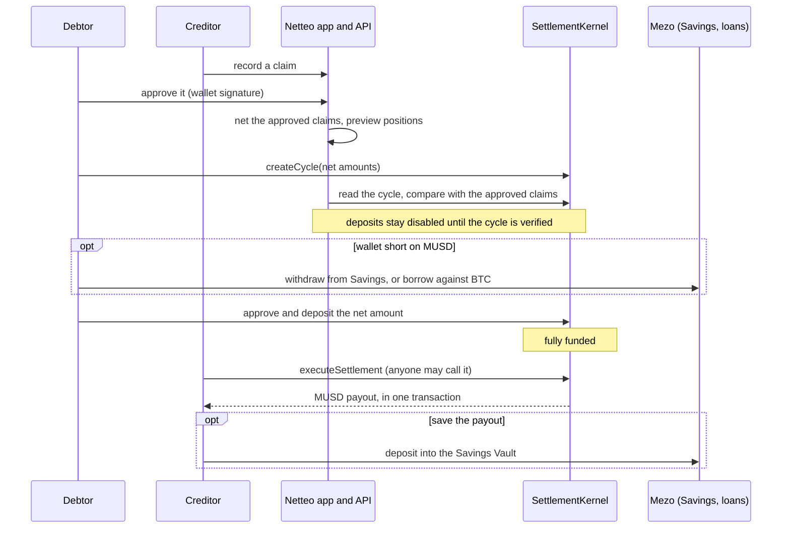

# Netteo

**Settle with your Bitcoin, not by selling it.**

Netteo cancels out what a group owes each other, settles only the net amount in MUSD on Mezo Mainnet, and lets each debtor cover their share from the MUSD Savings Vault or a loan against Bitcoin they already hold.

[](https://explorer.mezo.org)
[](https://netteo-six.vercel.app)
[](docs/SUBMISSION.md)

---

## See it in 60 seconds

| | |
|---|---|
| **Live app** | https://netteo-six.vercel.app |
| **Funding Check** (no wallet needed) | https://netteo-six.vercel.app/funding. Pick a real Bitcoin-backed loan on Mezo and see what it could fund. |
| **Real settlements and their transactions** | The **Evidence** section on the landing page, or [DEPLOYMENTS.md](DEPLOYMENTS.md) |
| **Documentation** | https://netteo-six.vercel.app/docs |

No wallet? Switch to **Demo** in the header to run the full flow on sample data. Demo is clearly labelled and never touches the chain.

---

## The idea

A working group, agency or DAO often owes itself money in loops. Paying every claim on its own means every debtor must find the full amount first, even though most of it cancels out.

| | Pay each claim separately | Netted by Netteo |
|---|---|---|
| A owes B 100, B owes C 80, C owes A 20 | 200 to find up front, 3 transfers | **80 deposited**, one payout transaction |

Less MUSD to find means less to sell or borrow. That is the point of Netteo for people who hold their wealth in Bitcoin on Mezo.

> How much a real group saves depends on how circular its debts are. A group with no loops saves nothing, and the saving is in what must be deposited, not a guaranteed saving in fees.

---

## What you can do

- **Record claims and get them approved.** Each debtor approves or disputes a claim with a wallet signature. Disputed claims are never netted.
- **Share a link** to a claim so the debtor lands right on it.
- **See the net positions** before anything touches the chain, then create the settlement cycle on Mezo.
- **Fund your share without selling Bitcoin.** If your wallet is short on MUSD, withdraw from the **MUSD Savings Vault**, or **borrow against your existing Bitcoin loan**. Netteo shows the fee, the interest, your collateral ratio and the price at which you would be liquidated, and refuses to build a borrow that leaves you under 150%.
- **Get paid and put it to work.** After a payout, deposit the MUSD in the Savings Vault in one step.
- **Check any wallet** with the read-only Funding Check.
- **Keep a record.** Receipts and a CSV export for every settlement, with links to the explorer.
- **Settle in MUSD, mUSDC or mUSDT.** One token per cycle, never mixed.

---

## How it uses Mezo

| Mezo component | What Netteo does with it | How it is verified |
|---|---|---|
| **MUSD** (and mUSDC, mUSDT) | The settlement asset. One settlement kernel per token. | Two real cycles on mainnet |
| **MUSD Savings Vault** | Withdraw to fund a deposit, deposit a payout, claim yield | A real mainnet round trip (3 transactions) |
| **BorrowerOperations, TroveManager, HintHelpers, SortedTroves, PriceFeed** | Read your Bitcoin-backed loan; borrow the missing MUSD against it, with placement hints | Live mainnet reads; the borrow itself on a mainnet fork using the real contracts |
| **Mezo RPC and explorer** | Three RPC providers with automatic failover; every transaction links to the explorer | Always on |

Protocol parameters (the 0.1% issuance fee, 1% interest, 110% minimum ratio, 1,800 MUSD minimum loan) are **read from the chain**, never hard-coded. Details are in the in-app docs under *Funding Without Selling Bitcoin* and *Mezo Protocol Contracts*.

---

## Proof it is real

Everything below was run on Mezo Mainnet, and `src/lib/chain/deployments.test.ts` re-checks every address, token binding, amount and transaction against the live chain.

| What | Result | Transactions |
|---|---|---|
| **v2 settlement** (current contracts) | A deposited 0.32 MUSD, B received 0.08, C received 0.24. Gross claims 0.80. Kernel left at 0. | [create](https://explorer.mezo.org/tx/0xdaceb9e491895ea5eb09caeb7c537f7d87b4318803c53cb1ee2ee47da122955e) · [deposit](https://explorer.mezo.org/tx/0x0340fd70a4e04fcf6d3b0787e5f8726cc99176b45e5f412610213bc8d3b457ce) · [execute](https://explorer.mezo.org/tx/0x9795326bd5fb24acd1fbbb869027bbdad231be58e9be98ab85d89226f3971f45) |
| **v1 settlement** (superseded) | A deposited 0.40 MUSD, B received 0.10, C received 0.30. Gross 1.00. | [create](https://explorer.mezo.org/tx/0xe2f2fb78315deb75edb117e84a401a51a057ed0b6c6d990c7f20a8688e2f7dce) · [deposit](https://explorer.mezo.org/tx/0x902a4912efc9fd508886f7ff767b294468312ed99fcaadc49dc597cc1a4a35b1) · [execute](https://explorer.mezo.org/tx/0x4093d636a434ae210740be916a0c10e927b40e6de9b8f1b24bdc7b7f159c3c2f) |
| **Savings Vault round trip** | 0.01 MUSD in, 0.01 MUSD out, every wei returned | [approve](https://explorer.mezo.org/tx/0x465b2b8693049f1fd96eab277a7c5f57d9c00f1fe67967c4887ae0ee6b5cd4a4) · [deposit](https://explorer.mezo.org/tx/0x582f2266b8408fb3126ef58e7f08bbe7021d8a0b006ab697685ea1c30d506091) · [withdraw](https://explorer.mezo.org/tx/0x2006cdd63fde64e2b0778522569431305dac09c1627a81d038e9bb4e9d9ba15c) |

Check a settlement yourself:

```bash
RPC=https://mezo-mainnet.boar.network
K=0x427Ff00c792252cC364Cb3240Dc26E6e7872340e   # MUSD kernel (v2)

# state 3 = Completed; also prints gross, net, funded and distributed totals
cast call $K "getCycle(bytes32)(bytes32,string,uint256,uint256,uint256,uint256,uint256,uint256,uint8,address)" \
  0x7ff4cbf39083469093a005be46bf698bd2d36b2d0c343374d4fecb224d32d420 --rpc-url $RPC
```

### Contracts (v2, current)

| Contract | Address |
|---|---|
| SettlementKernelFactory | [`0x95e35305d466dF41EF35E02AA53F1e90Db759a45`](https://explorer.mezo.org/address/0x95e35305d466dF41EF35E02AA53F1e90Db759a45) |
| SettlementKernel, MUSD | [`0x427Ff00c792252cC364Cb3240Dc26E6e7872340e`](https://explorer.mezo.org/address/0x427Ff00c792252cC364Cb3240Dc26E6e7872340e) |
| SettlementKernel, mUSDC | [`0xE229B3a2020FC19331E8A3e9662a2508fFF78020`](https://explorer.mezo.org/address/0xE229B3a2020FC19331E8A3e9662a2508fFF78020) |
| SettlementKernel, mUSDT | [`0xFecBE8a962F5C2628E877AA4C0C90C399549f18f`](https://explorer.mezo.org/address/0xFecBE8a962F5C2628E877AA4C0C90C399549f18f) |

v2 fixes three bugs found in an audit of v1: funds that could be locked in a stuck cycle, fee-on-transfer tokens, and cycle-id squatting. v1 holds no funds and the app does not use it. Fees, block numbers and what each version proves are in [DEPLOYMENTS.md](DEPLOYMENTS.md).

---

## How a settlement works



If a cycle is not fully funded by the deadline, each depositor takes back exactly what they deposited with `claimRefund`.

---

## Safety and trust

- **The contract has no owner, admin or pause function.** Funds leave it only through settlement or refund.
- **Every claim action is signed by the right wallet.** Signatures expire after five minutes and can be used once, so a replay is refused.
- **The browser cannot read or write private data.** The private tables have row-level security and no public policy; everything goes through an API that needs a signed wallet session.
- **A cycle must match the approved claims before anyone can deposit.** Anyone can create a cycle that names you as a debtor, so the server recomputes the netting and compares it with the chain first.
- **Borrowing has a safety floor.** Netteo never builds a borrow under 150% collateral. Mezo liquidates at 110%.
- **The API is rate limited** and shows users plain-language errors, never stack traces.

---

## Honest limits

- **The contracts have not been independently audited.**
- **Wallet flows were verified on a fork, not with a real wallet extension.** They were driven through the real UI with a scripted test wallet (see the wallet playground). A real wallet such as MetaMask has not yet been used end to end.
- **Borrowing against Bitcoin was not executed on mainnet by the team.** A new Mezo loan needs at least 1,800 MUSD of debt, far more than the test wallet holds. It is verified against the real Mezo contracts on a mainnet fork, and the reads are live. Netteo only borrows against a loan you already have.
- **MEZO and Mezo Passport are not integrated.** Passport pins React 18 and wagmi 2; this app is on React 19 and wagmi 3. MEZO needs testing with real funds on mainnet first.
- **Claim approvals live in the private database,** not on-chain. The server checks a cycle against them before deposits open, but the contract itself cannot.
- **Not yet tested with real groups.** The intended users are a hypothesis.
- **The rate limiter keeps counts per server instance,** so the effective limit is per instance.

---

## Run it yourself

You need Node.js 22, [Foundry](https://book.getfoundry.sh/getting-started/installation), and a free [Supabase](https://supabase.com) project.

```bash
git clone https://github.com/syther069/netteo.git
cd netteo
npm install
cp .env.example .env.local
```

1. In Supabase, run [`src/lib/db/schema.sql`](src/lib/db/schema.sql) in the SQL editor.
2. In `.env.local`, fill in `NEXT_PUBLIC_SUPABASE_URL`, `NEXT_PUBLIC_SUPABASE_ANON_KEY`, `SUPABASE_SERVICE_ROLE_KEY` and `SESSION_SECRET` (the file explains each). The Mezo contract addresses are already filled in with the public v2 deployment.
3. Run the app:

```bash
npm run dev    # http://localhost:3000
```

### Tests

```bash
npx tsc --noEmit    # typecheck
npm test            # TypeScript tests
forge test          # Solidity tests
npm run build       # production build
```

### Try the wallet flows without real funds

No wallet extension and no real money are needed to click through connecting, withdrawing from Savings, borrowing and saving a payout. The [wallet playground](scripts/wallet-playground/README.md) builds a funded test wallet (with a Mezo loan and Savings) on a free local fork of Mezo Mainnet, so the contracts are Mezo's real ones. It takes five short steps.

Some TypeScript tests read the live Mezo chain, so they catch a wrong address or a docs claim that drifted from reality: `deployments.test.ts` (every address, token binding, amount and transaction), `protocol.test.ts` (the Mezo contracts Netteo depends on) and `tokens.test.ts`. Set `SKIP_CHAIN_PROBE=1` to run offline.

The Mezo borrowing and Savings Vault test runs the real Mezo contracts on a free local fork of mainnet. Nothing is sent to the real chain:

```bash
anvil --fork-url https://mezo-mainnet.boar.network --port 8547
MEZO_MAINNET_FORK_URL=http://127.0.0.1:8547 npx tsx src/lib/mezo/fork.test.ts
```

The same kernel is also run against the real MUSD, mUSDC and mUSDT contract code: `MEZO_MAINNET_FORK_URL=https://mezo-mainnet.boar.network forge test --match-contract Fork`.

---

## Deploy

### The contracts

Deployment is irreversible and costs real BTC for gas (v2 cost 0.0000093827 BTC, roughly 60 US cents at today's BTC price). **Keep the deployer key out of plain-text files.** Import it into Foundry's encrypted keystore once:

```bash
cast wallet import deployer --interactive
```

```bash
# 1. Dry run: checks every token's code, decimals and symbol on-chain, deploys nothing
CONFIRM_MAINNET_DEPLOY=true forge script script/Deploy.s.sol:Deploy \
  --rpc-url https://mezo-mainnet.boar.network --account deployer --sender <your-address>

# 2. Broadcast: deploys the factory, then one kernel each for MUSD, mUSDC and mUSDT
CONFIRM_MAINNET_DEPLOY=true forge script script/Deploy.s.sol:Deploy \
  --rpc-url https://mezo-mainnet.boar.network --account deployer --sender <your-address> --broadcast
```

The script prints the `NEXT_PUBLIC_SETTLEMENT_KERNEL_*` values to use. `script/AcceptanceTest.s.sol` runs a real three-party cycle (read its header; `ACCEPTANCE_PERCENT` scales it down, and mainnet runs need `CONFIRM_MAINNET_ACCEPTANCE=true`). Rehearse for free first with `anvil --fork-url ...`.

### The web app

Set these on your host (names only; see `.env.example`):

| Variable | Purpose |
|---|---|
| `SUPABASE_SERVICE_ROLE_KEY` | Server only. The API cannot reach the database without it. |
| `SESSION_SECRET` | At least 32 random characters. Without it, sign-in fails closed. |
| `NEXT_PUBLIC_SUPABASE_URL`, `NEXT_PUBLIC_SUPABASE_ANON_KEY` | Public. The anon key can only read chain-derived tables. |
| `NEXT_PUBLIC_SETTLEMENT_KERNEL_FACTORY_ADDRESS`, `..._MUSD`, `..._MUSDC`, `..._MUSDT`, `..._DEPLOY_BLOCK` | The deployment addresses above. |
| `INDEXER_CRON_SECRET` (optional) | Protects `/api/indexer` for an external scheduler. |

**Upgrading an existing database, in this order:** deploy the new app first, then back up and run `src/lib/db/migrations/002` to `004` in order. Running `003` first locks out an older app. A fresh database only needs `schema.sql`.

Indexing needs no scheduler: loading cycles queues a throttled run.

---

## Project map

| Path | What is there |
|---|---|
| `contracts/` | `SettlementKernel` and `SettlementKernelFactory` (Solidity 0.8.24) |
| `test/contracts/` | Foundry tests, including mutation-checked fixes and real-token fork tests |
| `script/` | Deploy and acceptance scripts, with mainnet confirmation guards |
| `src/app/` | Next.js pages and the API routes (`/api/session`, `groups`, `obligations`, `cycles`, `indexer`) |
| `src/features/` | Product areas: claims, groups, settlements, funding, receipts, docs |
| `src/lib/mezo/` | The Mezo integration: borrowing math, chain reads, Savings Vault, hooks |
| `src/lib/chain/` | Token registry, deployments, RPC fallback, contract hooks |
| `src/lib/api/`, `src/lib/auth/` | Request handling, wallet sessions, signatures, rate limiting |
| `src/lib/db/` | Database schema and migrations |

---

## Read more

- **In-app documentation:** https://netteo-six.vercel.app/docs (architecture, security model, contract API, Mezo integration)
- [DEPLOYMENTS.md](DEPLOYMENTS.md): addresses, transactions, fees and what each deployment proves
- [docs/SUBMISSION.md](docs/SUBMISSION.md): answers for the Mezo Buildathon submission
- [PrD.md](PrD.md) and [architecture.md](architecture.md): the original product and architecture plans. They were written before the mainnet work, so the in-app docs and DEPLOYMENTS.md are the current source of truth.
