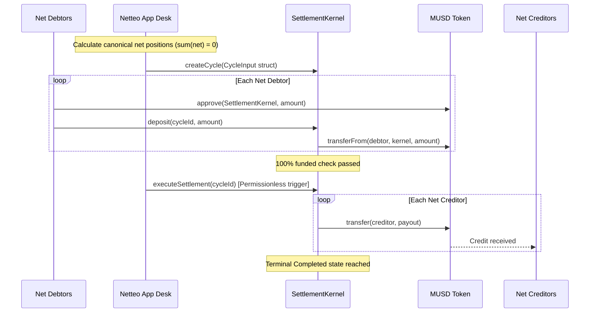

# Netteo — Multilateral Obligation Netting & MUSD Settlement on Mezo

> **Many obligations. One net settlement.**  
> Reconcile mutual payment obligations across Web3 service collectives and DAO working groups, calculate deterministic zero-sum net positions, and settle atomically in MUSD on Mezo Testnet.

[](https://explorer.test.mezo.org)
[](https://netteo-six.vercel.app)
[](https://docs.soliditylang.org)
[](https://nextjs.org)
[](https://www.typescriptlang.org)

**Live Production Application:** [https://netteo-six.vercel.app](https://netteo-six.vercel.app)  
**Verified Release & Demo Checklist:** [walkthrough.md](walkthrough.md)

---

## 1. Smart Contract Deployments (Mezo Testnet Chain 31611)

The protocol settlement contracts are compiled with Foundry (`via_ir = true`):

| Contract | Address | Status | Block Explorer |
|---|---|---|---|
| **Canonical Mezo MUSD** | `0x118917a40FAF1CD7a13dB0Ef56C86De7973Ac503` | Official Testnet Token | [View on Mezo Explorer](https://explorer.test.mezo.org/token/0x118917a40FAF1CD7a13dB0Ef56C86De7973Ac503) |
| **SettlementKernel (Live)** | `0x3c5Efa1E7fb42ec5351d132bcAce83C8C4dbc3D5` | Deployed (Canonical MUSD) | [View on Mezo Explorer](https://explorer.test.mezo.org/address/0x3c5Efa1E7fb42ec5351d132bcAce83C8C4dbc3D5) |
| **Legacy SettlementKernel** | `0x50bb6B07138414fE509B2E2936cF31C9de3e1BbA` | Deprecated (MockMUSD) | [View on Mezo Explorer](https://explorer.test.mezo.org/address/0x50bb6B07138414fE509B2E2936cF31C9de3e1BbA) |

---

## 2. Verified Live On-Chain Acceptance Settlement

A live multi-party settlement cycle was executed directly on Mezo Testnet:
- **Scenario:** 3 Participants:
  - Participant A owes Participant B: 100 MUSD gross
  - Participant B owes Participant C: 80 MUSD gross
  - Participant C owes Participant A: 20 MUSD gross
  - *Gross Obligation Volume:* **200 MUSD**
- **Deterministic Netting Calculation:**
  - Net Debtor A pays: **80 MUSD**
  - Net Creditor B receives: **20 MUSD**
  - Net Creditor C receives: **60 MUSD**
  - *Net Settlement Volume:* **80 MUSD** (60% reduction in capital lockup & transaction overhead)

### Verified Mezo Testnet Transaction Hashes

1. **Step 1: MUSD Allowance Approval**  
   Hash: [`0xb64b38c26b6014ef704d380805ccca2de64a1667fff439f07062f5e66f512291`](https://explorer.test.mezo.org/tx/0xb64b38c26b6014ef704d380805ccca2de64a1667fff439f07062f5e66f512291)
2. **Step 2: Cycle Creation (`createCycle`)**  
   Cycle ID: `0x156915a716581f2b7358b4561e75c90ae14f7404ed9aca9a30c5c4872a82ef4f`  
   Hash: [`0x313721ea293d6511735a44cfa30d4d60890f3879397d6bf6c4f6ca8e7eb97341`](https://explorer.test.mezo.org/tx/0x313721ea293d6511735a44cfa30d4d60890f3879397d6bf6c4f6ca8e7eb97341)
3. **Step 3: Net Debtor Funding (`deposit`)**  
   Hash: [`0x6c99d70ef12fef7b87405cd09ea828068cbcf61f745b91055b1374fcd05c382f`](https://explorer.test.mezo.org/tx/0x6c99d70ef12fef7b87405cd09ea828068cbcf61f745b91055b1374fcd05c382f)
4. **Step 4: Atomic Settlement Payout (`executeSettlement`)**  
   Hash: [`0x87b397ec8053f1d4c58dd23bdcc633d7f480cc137f18d496fb2fcec59f7dc491`](https://explorer.test.mezo.org/tx/0x87b397ec8053f1d4c58dd23bdcc633d7f480cc137f18d496fb2fcec59f7dc491)

*Result:* Creditor B received 20 MUSD, Creditor C received 60 MUSD atomically. Cycle reached terminal `Completed` state.

---

## 3. Architecture & Core Invariants



### Safety & Integrity Invariants
1. **Zero-Sum Balance ($\sum \text{net} = 0$):** Contract strictly verifies that total net debits equal total net credits before freezing a cycle.
2. **Collect-Then-Distribute:** No funds can be distributed until 100% of required net deposits have been locked.
3. **Mutual-Exclusion Refund:** If the funding deadline passes before 100% funding is reached, any deposited debtor can claim a 100% refund (`claimRefund`).
4. **Bounded Gas:** Participation is capped at 10 participants per cycle to guarantee execution within EVM block gas limits.
5. **Checks-Effects-Interactions & ReentrancyGuard:** Cycle state transitions occur prior to external token transfers.

---

## 4. Technology Stack

- **Smart Contracts:** Solidity `0.8.24`, OpenZeppelin Contracts v5 (`SafeERC20`, `ReentrancyGuard`), Foundry toolchain.
- **Frontend:** Next.js 16 (App Router, Turbopack), React 19, TypeScript strict mode.
- **Web3 Integration:** Viem 2.x, Wagmi 3.x, TanStack React Query.
- **Database & SSR:** Supabase (`@supabase/ssr`, `@supabase/supabase-js`) with Postgres Row-Level Security (RLS).
- **Design System:** Bespoke Netteo token system (`tokens.css`), Roundo typography, 120–240ms motion tokens, zero AI-slop guarantees.

---

## 5. Local Development & Testing

### Prerequisites
- Node.js >= 20.x
- Foundry (`forge`, `cast`)

### Setup
```bash
# Clone the repository
git clone https://github.com/syther069/netteo.git
cd netteo

# Install dependencies
npm install

# Copy environment variables
cp .env.example .env.local
```

### Run Tests
```bash
# Run unit and integration tests (25/25 passing)
npm test

# Run Solidity kernel invariant tests (6/6 passing)
forge test

# Run TypeScript typecheck
npm run typecheck

# Run production build
npm run build
```

### Run Dev Server
```bash
npm run dev
```
Open [http://localhost:3000](http://localhost:3000) in your browser.

---

## 6. Disclosures & Known Limitations

- **Gas Limit Boundaries:** Cycles are hard-capped at 10 participants to bound single-transaction loops within Mezo block gas limits. Larger groups settle in multiple sub-cycles.
- **Token Scope:** Settlement executes in single-currency MUSD (18 decimals). Multi-currency netting requires prior FX conversion.
- **Coordinator Liveness Independence:** Once 100% funded, `executeSettlement` is permissionless and can be triggered by any participant or automated bot.
