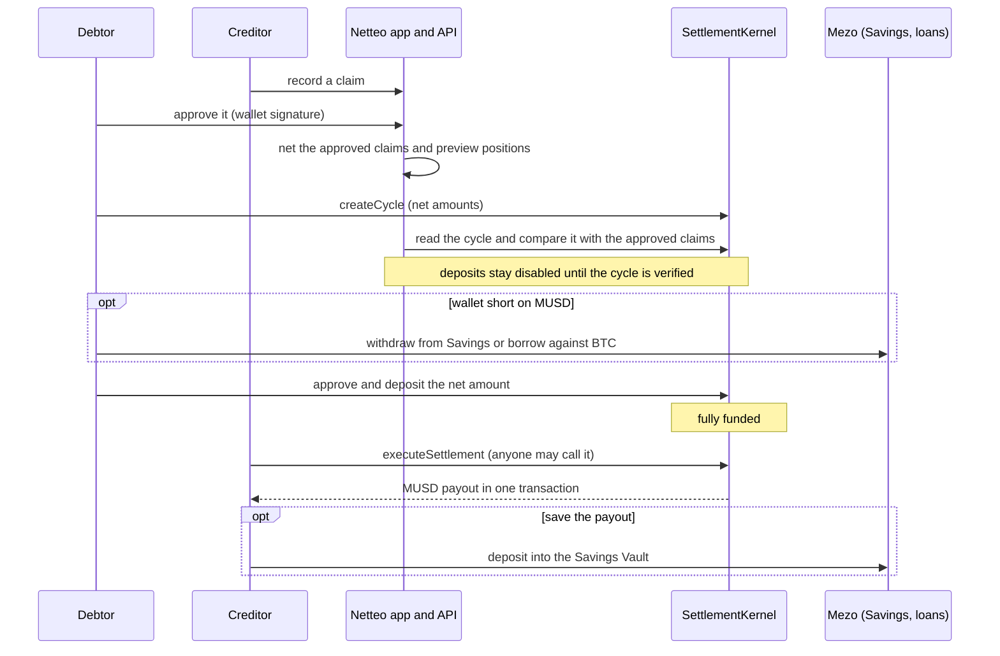

# Netteo

**Settle group payments on Mezo and fund them without selling your Bitcoin.**

Netteo cancels out what a group owes each other and settles only the net amount in MUSD on Mezo Mainnet. A debtor who is short can fund their share from the MUSD Savings Vault or a loan against Bitcoin they already hold.

Built by [Syther](https://x.com/SYther069) for the [Mezo Buildathon](https://app.akindo.io/wave-hacks/OVOO0gdrVU8379D10) (Wave 2).

| | |
|---|---|
| **Live app** | [netteo-six.vercel.app](https://netteo-six.vercel.app) |
| **Mezo integration** | [Docs: Mezo overview](https://netteo-six.vercel.app/docs?section=mezo-overview) |
| **On-chain evidence** | [Docs: Mainnet evidence](https://netteo-six.vercel.app/docs?section=mainnet-evidence) |
| **Deployed contracts** | [Docs: Deployed contracts](https://netteo-six.vercel.app/docs?section=deployed-contracts) |
| **Try without a wallet** | [Funding Check](https://netteo-six.vercel.app/funding) · [Settled MUSD cycle](https://netteo-six.vercel.app/cycles/0x7ff4cbf39083469093a005be46bf698bd2d36b2d0c343374d4fecb224d32d420) · [Its receipt](https://netteo-six.vercel.app/cycles/0x7ff4cbf39083469093a005be46bf698bd2d36b2d0c343374d4fecb224d32d420/audit) |

## Contents

[Problem](#the-problem) · [Solution](#what-netteo-solves) · [How it works](#how-it-works) · [Features](#features) · [Mezo integration](#mezo-integration) · [Deployments](#deployments) · [Evidence](#on-chain-evidence) · [Architecture](#architecture) · [API](#api-reference) · [Security and audit](#security-and-audit) · [Configuration](#configuration) · [Getting started](#getting-started) · [Testing](#testing) · [Deploying](#deploying) · [Structure](#project-structure) · [Changelog](#changelog) · [Roadmap](#roadmap) · [Limitations](#known-limitations) · [Credits](#credits) · [License](#license)

---

## The problem

Teams, DAOs and agencies owe each other money in loops. Alice owes Bob, Bob owes Charlie and Charlie owes Alice. Paying every claim on its own means every debtor must first find the full amount, even though most of it cancels out.

For people who hold their wealth in Bitcoin on Mezo, finding that amount means selling Bitcoin or borrowing more than the group needs.

## What Netteo solves

Netteo nets the claims first. Only what remains is deposited and every creditor is paid in one transaction.

| | Pay each claim separately | Netted by Netteo |
|---|---|---|
| Alice owes Bob 100, Bob owes Charlie 80, Charlie owes Alice 20 | 200 to find up front, 3 transfers | **80 deposited**, one payout transaction |

The saving depends on how circular a group's debts are. A group with no loops saves nothing. The saving is in what must be deposited, not a guaranteed saving in fees.

If a debtor is still short on MUSD, Netteo reads their Mezo loan and Savings balance live. It offers to withdraw from the **MUSD Savings Vault** or borrow the missing amount against Bitcoin they already hold. It will not build a borrow that leaves the loan under 150% collateral.

## How it works



1. **Record.** A creditor records a claim against a debtor inside a group.
2. **Approve.** The debtor approves or disputes it with a wallet signature. Disputed claims are never netted.
3. **Net.** Netteo computes one net position per person and previews it before anything touches the chain.
4. **Create and verify.** The settlement cycle is created on Mezo. The server recomputes the netting and compares it with the chain. Deposits open only on a match.
5. **Fund.** Each net debtor deposits their share, using Savings or a loan if needed.
6. **Settle.** Once fully funded, anyone can execute the payout. Every creditor is paid atomically.
7. **Refund.** If the deadline passes without full funding, each depositor takes back exactly what they put in.

## Features

<details open>
<summary><b>Settlement</b></summary>

- Claims with signed approval, dispute and withdrawal
- Share links that open a claim directly for the debtor
- Net preview before anything touches the chain
- Settlement in MUSD, mUSDC or mUSDT, one token per cycle and never mixed
- Receipts and CSV export for every settlement, with explorer links

</details>

<details open>
<summary><b>Funding without selling Bitcoin</b></summary>

- Withdraw from the MUSD Savings Vault to fund a deposit
- Borrow the missing MUSD against an existing Bitcoin loan, showing the fee, the interest, the collateral ratio and the liquidation price
- Deposit a payout into the Savings Vault in one step
- Read-only Funding Check for any wallet, no connection needed

</details>

<details>
<summary><b>Product behaviour</b></summary>

- Live mode on Mezo Mainnet and a clearly labelled Demo sandbox that never touches the chain
- Receipts and settlement pages load straight from the contract, with no wallet or local record
- Offline detection, double-submit protection and plain-language errors on every screen
- Light and dark themes, responsive down to phone width

</details>

## Mezo integration

Details and verification for each component are in the [Mezo overview docs](https://netteo-six.vercel.app/docs?section=mezo-overview).

| Mezo component | What Netteo does with it | Verified by |
|---|---|---|
| **MUSD**, mUSDC, mUSDT | Settlement asset, one kernel per token | Real mainnet cycles in MUSD and mUSDC |
| **MUSD Savings Vault** | Withdraw to fund a deposit, deposit a payout, claim yield | Real mainnet round trip, 3 transactions |
| **BorrowerOperations, TroveManager, HintHelpers, SortedTroves, PriceFeed** | Read a loan, price it and borrow the missing MUSD with placement hints | Live mainnet reads. Borrow tested on a mainnet fork against the real contracts |
| **Mezo RPC and explorer** | Three RPC providers with automatic failover. Every transaction links to the explorer | Always on |

Protocol parameters (0.1% issuance fee, 1% interest, 110% minimum ratio and 1,800 MUSD minimum loan) are read from the chain and never hard-coded.

## Deployments

Mezo Mainnet, chain ID `31612`. Full record with blocks, fees and opcode checks: [DEPLOYMENTS.md](DEPLOYMENTS.md). Live list: [Deployed contracts docs](https://netteo-six.vercel.app/docs?section=deployed-contracts).

| Contract (v2, current) | Address |
|---|---|
| SettlementKernelFactory | [`0x95e35305d466dF41EF35E02AA53F1e90Db759a45`](https://explorer.mezo.org/address/0x95e35305d466dF41EF35E02AA53F1e90Db759a45) |
| SettlementKernel, MUSD | [`0x427Ff00c792252cC364Cb3240Dc26E6e7872340e`](https://explorer.mezo.org/address/0x427Ff00c792252cC364Cb3240Dc26E6e7872340e) |
| SettlementKernel, mUSDC | [`0xE229B3a2020FC19331E8A3e9662a2508fFF78020`](https://explorer.mezo.org/address/0xE229B3a2020FC19331E8A3e9662a2508fFF78020) |
| SettlementKernel, mUSDT | [`0xFecBE8a962F5C2628E877AA4C0C90C399549f18f`](https://explorer.mezo.org/address/0xFecBE8a962F5C2628E877AA4C0C90C399549f18f) |

v1 is superseded. It holds no funds and the app does not use it. v2 fixes three issues found in a review of v1: funds that could be locked in a stuck cycle, fee-on-transfer tokens and cycle id squatting.

## On-chain evidence

Everything below ran on Mezo Mainnet. `src/lib/chain/deployments.test.ts` re-checks every address, token binding, amount and transaction against the live chain. Full detail: [Mainnet evidence docs](https://netteo-six.vercel.app/docs?section=mainnet-evidence).

| Run | Result | Transactions |
|---|---|---|
| **MUSD settlement (v2)** | A deposited 0.32 MUSD. B received 0.08 and C received 0.24. Gross claims 0.80. Kernel left at 0 | [create](https://explorer.mezo.org/tx/0xdaceb9e491895ea5eb09caeb7c537f7d87b4318803c53cb1ee2ee47da122955e) · [deposit](https://explorer.mezo.org/tx/0x0340fd70a4e04fcf6d3b0787e5f8726cc99176b45e5f412610213bc8d3b457ce) · [execute](https://explorer.mezo.org/tx/0x9795326bd5fb24acd1fbbb869027bbdad231be58e9be98ab85d89226f3971f45) |
| **mUSDC settlement (v2)**, 6 decimals | A deposited 0.004 mUSDC. B received 0.001 and C received 0.003. Gross 0.01. Kernel left at 0 | [create](https://explorer.mezo.org/tx/0xa995a681dd58fde22b3bee90820c0611ed498a55d7ef1d833ef5641c4e5cbcb8) · [deposit](https://explorer.mezo.org/tx/0xb64b8fce7afa90a3cbd31d196b452f09b31934afbfa5d7f3fd2d7434423b019d) · [execute](https://explorer.mezo.org/tx/0xc1b2477636805830b8e661467f711f18f173e6527c42ffecd4b6bfd112c5547e) |
| **MUSD settlement (v1)**, superseded | A deposited 0.40 MUSD. B received 0.10 and C received 0.30. Gross 1.00 | [create](https://explorer.mezo.org/tx/0xe2f2fb78315deb75edb117e84a401a51a057ed0b6c6d990c7f20a8688e2f7dce) · [deposit](https://explorer.mezo.org/tx/0x902a4912efc9fd508886f7ff767b294468312ed99fcaadc49dc597cc1a4a35b1) · [execute](https://explorer.mezo.org/tx/0x4093d636a434ae210740be916a0c10e927b40e6de9b8f1b24bdc7b7f159c3c2f) |
| **Savings Vault round trip** | 0.01 MUSD in and 0.01 MUSD out | [approve](https://explorer.mezo.org/tx/0x465b2b8693049f1fd96eab277a7c5f57d9c00f1fe67967c4887ae0ee6b5cd4a4) · [deposit](https://explorer.mezo.org/tx/0x582f2266b8408fb3126ef58e7f08bbe7021d8a0b006ab697685ea1c30d506091) · [withdraw](https://explorer.mezo.org/tx/0x2006cdd63fde64e2b0778522569431305dac09c1627a81d038e9bb4e9d9ba15c) |

These cycles were created and settled by one signer paying two other addresses. They demonstrate the settlement mechanics and the token movement, not a multi-party funding flow.

<details>
<summary><b>Verify a settlement yourself</b></summary>

With [Foundry](https://book.getfoundry.sh) installed:

```bash
RPC=https://mezo-mainnet.boar.network
K=0x427Ff00c792252cC364Cb3240Dc26E6e7872340e   # MUSD kernel (v2)

# state 3 = Completed. Also prints gross, net, funded and distributed totals
cast call $K "getCycle(bytes32)(bytes32,string,uint256,uint256,uint256,uint256,uint256,uint256,uint8,address)" \
  0x7ff4cbf39083469093a005be46bf698bd2d36b2d0c343374d4fecb224d32d420 --rpc-url $RPC
```

</details>

## Architecture

| Layer | Technology | Role |
|---|---|---|
| Contracts | Solidity 0.8.24, Foundry | `SettlementKernel` holds deposits until a cycle is fully funded and then pays every creditor atomically. `SettlementKernelFactory` creates one kernel per token. No owner, admin or pause |
| Web app | Next.js 16, React 19, TypeScript | Claims, groups, netting preview, cycle execution, receipts, documentation |
| Wallet and chain | wagmi 3, viem 2, RainbowKit | Wallet connection, signatures, contract reads and writes, RPC failover |
| API | Next.js route handlers | Wallet sessions, signed actions, replay protection, rate limiting, cycle verification |
| Data | Supabase Postgres with row-level security | Private claim ledger (service role only) and public chain projections written by an event indexer |
| Hosting | Vercel | Deploys from `main` |

**State machines.** Each lifecycle is one small pure module shared by the API, the screens and the tests.

| Lifecycle | States |
|---|---|
| Payment claim | proposed, then accepted, disputed or withdrawn. A cycle later freezes and settles accepted claims |
| Settlement cycle | Funding, ReadyToSettle, Completed, Expired, Refunded, Cancelled |
| Wallet transaction | idle, wallet, confirming, then success or error |
| List screen | loading, error, ready, needs-wallet, empty |

## API reference

All routes are JSON. Private routes need `Authorization: Bearer <session token>`.

| Method | Route | Auth | Purpose |
|---|---|---|---|
| `POST` | `/api/session` | Signed message | Verifies a wallet signature and returns a 1 hour session token |
| `GET` | `/api/groups` | Session | Groups the wallet belongs to |
| `POST` | `/api/groups` | Signature or session | Create a group (signature) or update its participants (session) |
| `GET` | `/api/obligations` | Session | Claims in the wallet's groups or naming it as debtor, creditor or proposer |
| `POST` | `/api/obligations` | Signature | Propose a claim or accept, dispute or withdraw one |
| `GET` | `/api/cycles` | Session | Cycles the wallet is part of |
| `POST` | `/api/cycles` | Session | Register a cycle. The server recomputes the netting and compares it with the chain |
| `GET`, `POST` | `/api/indexer` | `Bearer` cron secret | Ingests contract events into the public projections |

**Errors.** Failures return `{ "error": "<plain-language message>" }`. Claim actions add a machine-readable `code`: `wrong_state` (409), `not_debtor` (403) or `not_party` (403). Over the rate limit the API returns `429`. A database outage returns `503`, never an empty list.

**Rate limits** per caller: 10 per minute for sign-in, 30 for signed writes and 120 for reads.

## Security and audit

**Audit status.** The contracts have **not** been independently audited. An internal review of v1 found three issues and v2 fixes them. Each fix is mutation-checked: reverting it makes a test fail.

| Finding in v1 | Fix in v2 |
|---|---|
| A fully funded cycle that cannot pay out could lock funds | Deposits are refundable after the funding deadline plus a 3 day grace period |
| Fee-on-transfer tokens could break accounting | Every deposit must raise the kernel balance by exactly the booked amount, otherwise it reverts |
| Cycle ids could be squatted | The id is `keccak256(creator, salt)`, so nobody can pre-create another wallet's id |

**Controls**

| Area | Control |
|---|---|
| Contract | No owner, admin or pause function. Funds leave only through settlement or refund. Reentrancy guard and safe token transfers. At most 10 participants per cycle. Funding window from 1 hour to 30 days |
| Signatures | Every claim action is a wallet message signature (EIP-191). It expires after 5 minutes and each nonce is accepted once, stored in the database so replays fail across serverless instances |
| Sessions | HMAC-signed, valid for 1 hour. If `SESSION_SECRET` is missing, sign-in fails closed |
| Database | Row-level security on and no public policy on private tables. Only the API, using the service role key, can read or write them. The key never reaches the browser |
| Cycle verification | Anyone can create a cycle naming you as a debtor, so the server compares each cycle with the approved claims before deposits open |
| Borrowing | Netteo never builds a borrow under 150% collateral. Mezo liquidates at 110% |
| Errors | Users see plain-language messages. Stack traces, paths and schema details stay in server logs |
| Abuse | Per-caller rate limits on every route |

**Tests.** 57 Solidity tests (kernel invariants, 6-decimal tokens, deploy script safety and fork tests against the real MUSD, mUSDC and mUSDT bytecode) and a TypeScript suite covering netting, the API, signatures, sessions, state machines and live-chain checks. CI runs them on every push.

**Reporting a vulnerability.** Please do not open a public issue. Send a direct message to [Syther on X](https://x.com/SYther069) with the details.

## Configuration

Copy `.env.example` to `.env.local`. The Mezo addresses are prefilled with the public v2 deployment.

| Variable | Scope | Required | Purpose |
|---|---|---|---|
| `NEXT_PUBLIC_SETTLEMENT_KERNEL_FACTORY_ADDRESS` | Public | Yes | Factory address |
| `NEXT_PUBLIC_SETTLEMENT_KERNEL_MUSD`, `_MUSDC`, `_MUSDT` | Public | Yes | One kernel per token |
| `NEXT_PUBLIC_SETTLEMENT_KERNEL_DEPLOY_BLOCK` | Public | Yes | First block the indexer reads |
| `NEXT_PUBLIC_SUPABASE_URL` | Public | Yes | Supabase project URL |
| `NEXT_PUBLIC_SUPABASE_ANON_KEY` | Public | Yes | Can only read chain-derived tables |
| `SUPABASE_SERVICE_ROLE_KEY` | **Server only** | Yes | API access to the private tables |
| `SESSION_SECRET` | **Server only** | Yes | At least 32 random characters. Signs session tokens |
| `INDEXER_CRON_SECRET` | **Server only** | Optional | Protects `/api/indexer` for an external scheduler |
| `NEXT_PUBLIC_MEZO_MAINNET_RPC_URL` | Public | Optional | Primary RPC. Two other providers are used as fallbacks |

## Getting started

Requirements: Node.js 22, [Foundry](https://book.getfoundry.sh/getting-started/installation) and a [Supabase](https://supabase.com) project.

```bash
git clone https://github.com/syther069/netteo.git
cd netteo
npm install
cp .env.example .env.local
```

1. In Supabase, run [`src/lib/db/schema.sql`](src/lib/db/schema.sql) in the SQL editor.
2. In `.env.local`, set the Supabase variables and `SESSION_SECRET`.
3. Start the app:

```bash
npm run dev    # http://localhost:3000
```

**Try wallet flows without real funds.** The [wallet playground](scripts/wallet-playground/README.md) builds a funded test wallet, with a Mezo loan and Savings, on a local fork of Mezo Mainnet. You can click through connecting, withdrawing from Savings, borrowing and saving a payout against Mezo's real contracts.

## Testing

```bash
npm run typecheck   # TypeScript
npm test            # TypeScript tests
forge test          # Solidity tests
npm run build       # production build
```

Some tests read the live Mezo chain so that a wrong address or outdated documentation fails the build. Set `SKIP_CHAIN_PROBE=1` to run offline. The borrowing and Savings test runs against a local fork and sends nothing to the real chain:

```bash
anvil --fork-url https://mezo-mainnet.boar.network --port 8547
MEZO_MAINNET_FORK_URL=http://127.0.0.1:8547 npx tsx src/lib/mezo/fork.test.ts
```

The kernel also runs against the real MUSD, mUSDC and mUSDT contract code:

```bash
MEZO_MAINNET_FORK_URL=https://mezo-mainnet.boar.network forge test --match-contract Fork
```

## Deploying

<details>
<summary><b>Contracts</b></summary>

Deployment is irreversible and costs real BTC for gas (v2 cost 0.0000093827 BTC). Keep the deployer key out of plain-text files by importing it into Foundry's encrypted keystore:

```bash
cast wallet import deployer --interactive

# 1. Dry run: checks each token's code, decimals and symbol on-chain and deploys nothing
CONFIRM_MAINNET_DEPLOY=true forge script script/Deploy.s.sol:Deploy \
  --rpc-url https://mezo-mainnet.boar.network --account deployer --sender <your-address>

# 2. Broadcast: deploys the factory and one kernel each for MUSD, mUSDC and mUSDT
CONFIRM_MAINNET_DEPLOY=true forge script script/Deploy.s.sol:Deploy \
  --rpc-url https://mezo-mainnet.boar.network --account deployer --sender <your-address> --broadcast
```

The script prints the `NEXT_PUBLIC_SETTLEMENT_KERNEL_*` values to use. `script/AcceptanceTest.s.sol` runs a real three-party cycle. `ACCEPTANCE_PERCENT` scales it down and mainnet runs need `CONFIRM_MAINNET_ACCEPTANCE=true`.

</details>

<details>
<summary><b>Web app</b></summary>

Set the variables from [Configuration](#configuration) on your host. To upgrade an existing database, deploy the new app first, then back up and run `src/lib/db/migrations/002` to `004` in order. Running `003` first locks out an older app. A fresh database only needs `schema.sql`. Indexing needs no scheduler because loading cycles queues a throttled run.

</details>

## Project structure

| Path | Contents |
|---|---|
| `contracts/` | Solidity contracts |
| `test/contracts/` | Foundry tests, including real-token fork tests |
| `script/` | Deploy and acceptance scripts with mainnet confirmation guards |
| `src/app/` | Pages and API routes |
| `src/features/` | Claims, groups, settlements, funding, receipts and docs |
| `src/lib/` | Mezo integration, chain access, API handlers, auth and database |
| `scripts/` | Brand asset generation and the wallet playground |
| `assets/` | Source logo |

## Changelog

| Date | Change |
|---|---|
| 2026-11-15 | Real mUSDC settlement on mainnet. Receipts and cycle pages load from chain with no wallet. State machines for claims, cycles, transactions and screens. Wallet playground. Cleaner repository and README |
| 2026-11-14 | Mezo funding: Savings Vault and loan against Bitcoin. API rate limiting. Claim share links. Locked-down API with wallet sessions. Multi-token v2 kernels. Real mainnet evidence added to the app. Live mode is the default |
| 2026-11-13 | v2 contracts deployed to Mezo Mainnet |
| 2026-11-12 | v1 contracts deployed to Mezo Mainnet |
| 2026-10-21 to 2026-10-26 | First protocol and app on Mezo Testnet, followed by the documentation portal and brand work |

## Roadmap

Planned work, not commitments.

- [ ] Typed-data (EIP-712) approvals with a signature bundle in each receipt, so anyone can re-verify who agreed to what
- [ ] Independent smart-contract audit
- [ ] Test with a browser wallet extension such as MetaMask end to end
- [ ] Mezo Passport support once it supports React 19 and wagmi 3
- [ ] MEZO as a settlement token after tests with real MEZO on mainnet
- [ ] Recurring settlement cycles and notifications
- [ ] Shared-store rate limiting across server instances
- [ ] A mainnet cycle funded by several independent wallets

## Known limitations

- The contracts have not been independently audited.
- Wallet flows were verified with a scripted test wallet on a fork, driven through the real interface. A browser wallet extension has not been used end to end.
- The team has not executed a borrow against Bitcoin on mainnet. A new Mezo loan needs at least 1,800 MUSD of debt. The borrow is verified against the real Mezo contracts on a mainnet fork and the reads are live. Netteo only borrows against an existing loan.
- MEZO and Mezo Passport are not integrated. Passport pins React 18 and wagmi 2 while this app uses React 19 and wagmi 3.
- Claim approvals live in the private database, not on-chain. The server checks a cycle against them before deposits open, but the contract cannot.
- The mainnet cycles were run by a single signer.
- The target users are a hypothesis. The product has not been tested with real groups.
- The rate limiter counts per server instance.

## Credits

**Author:** [Syther](https://x.com/SYther069)

**Protocol and infrastructure**
- [Mezo](https://mezo.org) for MUSD, mUSDC and mUSDT, the MUSD Savings Vault, the borrowing contracts, the public RPC providers and the explorer
- [Mezo Buildathon](https://app.akindo.io/wave-hacks/OVOO0gdrVU8379D10) on AKINDO
- [Supabase](https://supabase.com) for Postgres and row-level security
- [Vercel](https://vercel.com) for hosting

**Open-source software**
- [OpenZeppelin Contracts](https://github.com/OpenZeppelin/openzeppelin-contracts) for token interfaces, safe transfers and the reentrancy guard
- [Foundry](https://github.com/foundry-rs/foundry) for building and testing the contracts
- [Next.js](https://nextjs.org) and [React](https://react.dev)
- [wagmi](https://wagmi.sh) and [viem](https://viem.sh) for wallet and chain access
- [RainbowKit](https://www.rainbowkit.com) for the wallet connection dialog
- [TanStack Query](https://tanstack.com/query) for data fetching
- [Lucide](https://lucide.dev) for icons and [Framer Motion](https://www.framer.com/motion) for animation
- [TypeScript](https://www.typescriptlang.org)

The Roundo typeface files in `public/fonts` belong to their original authors. Check their license before reusing them.

## License

Copyright (c) 2026 Syther. All rights reserved.

The source is published so that the Mezo Buildathon submission can be reviewed and evaluated. No permission is granted to copy, modify, distribute or use it commercially without written permission from the author. See [LICENSE](LICENSE).
