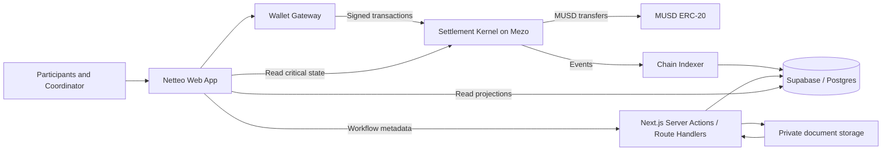
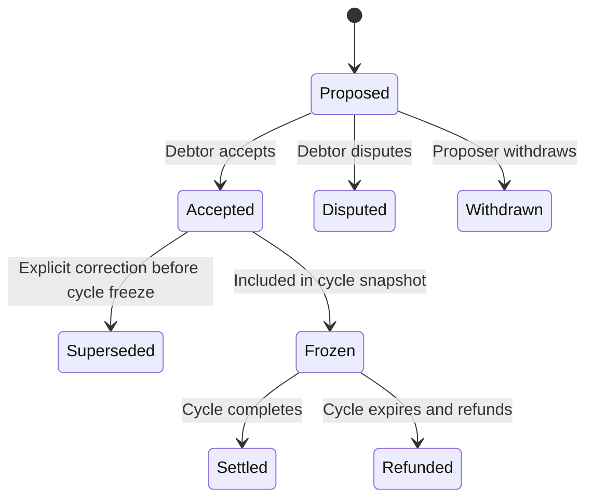
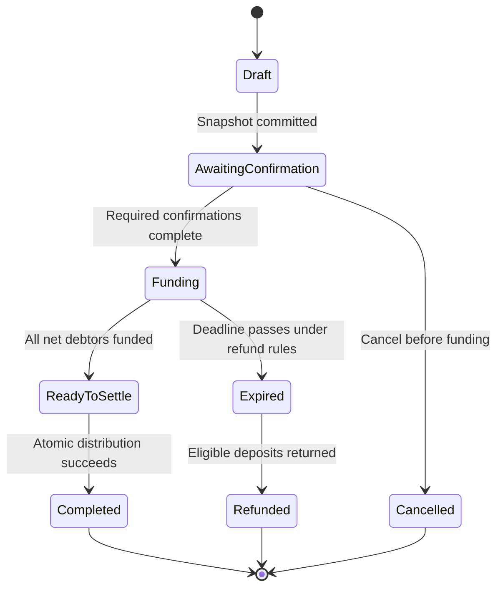
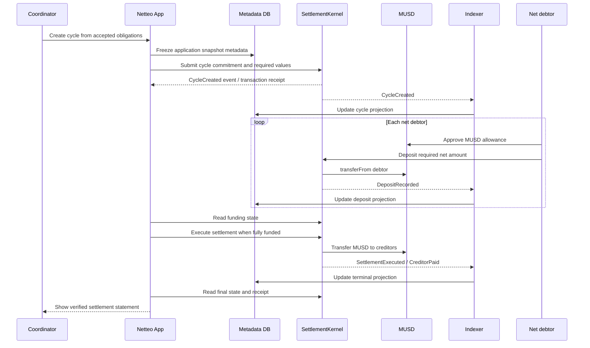

# Netteo — Architecture

**System:** Netteo multilateral MUSD settlement  
**Target:** Mezo testnet for MVP  
**Version:** 1.0  
**Last updated:** 20 October 2026

---

## 1. Architecture thesis

Netteo should be built around one durable boundary:

> **The contract owns money and settlement state. The application owns the workflow and explanation of that state.**

This is not a generic web3 dashboard backed by a database. The settlement cycle is the core domain object, and every subsystem exists to move a cycle safely from accepted obligations to a terminal state.

The architecture separates three kinds of truth:

1. **Claim truth:** what participants proposed and accepted as obligations.
2. **Settlement truth:** the frozen set of eligible obligations, calculated net positions, deposits and terminal payouts enforced by the contract.
3. **Presentation truth:** names, descriptions, document references, activity feeds and query-friendly views stored off-chain.

Only the second category can authorize movement of MUSD. The database may index it, but cannot override it.

## 2. The chosen architecture: a settlement kernel with an indexed ledger

Use a small number of explicit modules rather than a broad microservice architecture.

- **Settlement Kernel (Solidity):** owns cycle lifecycle, immutable cycle inputs, net balances, deposits, distribution and refunds.
- **Obligation Desk (Next.js domain layer):** handles proposals, debtor acceptance/dispute, cycle assembly and policy checks.
- **Chain Indexer (server-side worker):** consumes contract events, verifies them against the configured chain, and maintains query-friendly projections.
- **Evidence Store (Supabase/Postgres):** stores non-sensitive metadata and the indexer's projections; it is not authoritative for funds.
- **Wallet Gateway (browser):** signs user actions and sends transactions. It never receives private keys from Netteo.
- **Settlement Read Model (UI):** displays a cycle from indexed data, with direct chain reads for critical state and transaction confirmation.

This shape is deliberately a **modular monolith plus one event-indexing worker**, not microservices. The MVP does not need distributed service orchestration, a message broker, or separate deployments for every domain concern.

## 3. System context



### Trust boundaries

- The wallet and browser are untrusted. They can display stale data, be manipulated, or submit duplicate requests.
- The Next.js server and database are workflow infrastructure, not custody infrastructure.
- The indexer can fail, lag or process events twice; projections must be replayable.
- The contract is the final authority for token movement and settlement terminal state.
- The MUSD token contract is an external dependency whose exact deployed behavior must be tested.

## 4. Domain model

### 4.1 Group

A group is a named collection of participants with a membership policy. It is primarily an application-level coordination construct. On-chain group membership should be represented only to the extent needed to authorize settlement operations.

Fields:
- `id`
- `created_by`
- `name`
- `description` (non-sensitive)
- `policy_version`
- `participant_limit`
- `created_at`
- `status`

### 4.2 Participant

A participant is a wallet address associated with a group and optional display metadata.

Fields:
- `group_id`
- `wallet_address` (normalized lowercase for database indexing; checksum format for display)
- `role`
- `membership_status`
- `joined_at`

A wallet address is an identifier, not proof of a real-world identity.

### 4.3 Obligation

An obligation is a directed claim: debtor owes creditor a specific amount of MUSD. It is not itself a token transfer.

Fields:
- `id`
- `group_id`
- `proposer_address`
- `debtor_address`
- `creditor_address`
- `amount_units` (integer string / numeric-safe representation)
- `reference_label` (non-sensitive)
- `due_at` (optional)
- `status`
- `accepted_at`
- `disputed_at`
- `document_reference` (private off-chain pointer, never a public URL)
- `created_at`
- `updated_at`

Allowed states:
`Proposed → Accepted | Disputed | Withdrawn`

Accepted obligations can be superseded only through an explicit, auditable action before cycle freeze. Once frozen into a cycle, their values are immutable for that cycle.

### 4.4 Settlement cycle

A cycle is the single most important domain object. It freezes an eligible obligation set and turns the resulting net positions into one funding and distribution operation.

Fields:
- `cycle_id`
- `group_id`
- `cycle_number`
- `obligation_commitment`
- `algorithm_version`
- `participant_count`
- `obligation_count`
- `gross_obligation_total`
- `net_debtor_total`
- `funding_deadline`
- `state`
- `created_by`
- `created_at`
- `funded_at`
- `completed_at`
- `refunded_at`

The cycle's exact obligation set must be reproducible from a canonical encoding and committed before funding. The implementation decision is either:
1. store the required obligation records and values directly in contract storage; or
2. store a commitment to a canonical obligation snapshot, with all values needed for netting and enforcement supplied and validated against that commitment.

For a hackathon MVP, prefer the simplest implementation that safely supports the participant and obligation cap. Do not introduce cryptographic commitments merely to sound sophisticated; use them only if the contract actually verifies canonical inputs and the snapshot remains available.

### 4.5 Net position and allocation

For each participant `p`:

`net[p] = incoming_accepted_amounts[p] - outgoing_accepted_amounts[p]`

- Positive value: creditor.
- Negative value: debtor.
- Zero: no net funding requirement.

The contract or a contract-validated input must enforce:
- all net positions sum to zero;
- total positive positions equal absolute total negative positions;
- no allocation exceeds a participant's net credit or net debit;
- each included obligation appears exactly once;
- all values use MUSD base units;
- the allocation is deterministic and fixed before funding.

The initial algorithm may be a deterministic debtor-to-creditor allocation, not a claimed globally optimal transfer-minimization algorithm. Version the algorithm and test it against an independent reference implementation.

## 5. State machines

### 5.1 Obligation state machine



An obligation in `Frozen` cannot be edited or removed from that cycle. A correction requires a new obligation or a new cycle according to policy; never mutate the historical input after funding begins.

### 5.2 Settlement cycle state machine



`Completed`, `Refunded`, and `Cancelled` are terminal. No transition may lead from one terminal state to another.

**Important implementation note:** If participant confirmations are stored on-chain, their scope must bind to the exact `obligation_commitment`, algorithm version, MUSD token, allocation, and deadline. A confirmation for an earlier snapshot must never authorize a changed snapshot.

## 6. Contract design

### 6.1 SettlementKernel

One non-upgradeable contract for the MVP, unless a documented requirement proves upgradeability is essential. Avoid proxy complexity during a short hackathon.

Responsibilities:
- create cycle with a unique ID and fixed MUSD token address;
- validate participant and obligation bounds;
- validate accepted-obligation snapshot or on-chain obligation records;
- calculate or verify net positions;
- record required funding per net debtor;
- accept deposits from the relevant debtor only;
- enforce funding deadline and state transitions;
- distribute to net creditors only after full funding;
- allow refunds only after valid expiry and only once;
- emit events sufficient to reconstruct the cycle.

Suggested external interface (names are illustrative; finalize before implementation):

```solidity
createCycle(CycleInput input) returns (bytes32 cycleId)
confirmCycle(bytes32 cycleId, bytes32 commitment)
deposit(bytes32 cycleId, uint256 amount)
executeSettlement(bytes32 cycleId)
expireCycle(bytes32 cycleId)
claimRefund(bytes32 cycleId)
getCycle(bytes32 cycleId)
getParticipantPosition(bytes32 cycleId, address participant)
```

Do not copy this interface mechanically. The final functions depend on whether the obligation records or snapshot are stored directly on-chain and whether participants must confirm individually.

### 6.2 Atomic distribution

The recommended lifecycle is collect-then-distribute:

1. Each net debtor deposits the exact amount due.
2. The contract records deposits against the cycle.
3. Distribution remains disabled until the funded total equals the required total and every debtor has met their requirement.
4. `executeSettlement` transfers MUSD to all net creditors and marks the cycle completed in the same transaction.
5. If a transfer fails, the transaction reverts and no partial state persists.
6. If the deadline expires before full funding, the cycle enters the refund path and each depositor can recover the amount attributed to them.

The contract should not depend on a coordinator to decide who gets paid once the cycle is fully funded. Distribution should be callable by any address after the objective preconditions are satisfied, avoiding a coordinator liveness bottleneck.

### 6.3 Security controls

- Use OpenZeppelin `SafeERC20` and `ReentrancyGuard` or equivalent vetted primitives.
- Apply checks-effects-interactions and update cycle state before external token transfers where appropriate.
- Use integer base units only; read and verify MUSD decimals from the deployed token.
- Prevent duplicate deposits, duplicate obligation inclusion, duplicate settlement and duplicate refunds.
- Restrict cycle creation and membership administration to authorized actors.
- Freeze inputs before accepting any deposits.
- Enforce small hard limits on participants and obligations to bound gas.
- Test token transfer behavior on the actual target network.
- Never rely on frontend role checks for contract authorization.
- Do not implement arbitrary admin withdrawal of funds from active cycles.
- Include emergency pause only if a precise pause policy exists; pause must not strand user deposits without a documented recovery path.

### 6.4 Events

At minimum, emit events equivalent to:
- `CycleCreated`
- `CycleConfirmed`
- `ObligationIncluded`
- `DepositRecorded`
- `SettlementExecuted`
- `CreditorPaid`
- `CycleExpired`
- `RefundClaimed`

Avoid putting confidential descriptions, names, email addresses, or private document URLs in events. Event payloads should be sufficient to verify accounting without exposing unnecessary business data.

## 7. Application architecture

### 7.1 Frontend

Use Next.js App Router with TypeScript. Organize by business capability rather than one giant component tree.

Suggested structure:

```text
src/
  app/
    (app)/
      dashboard/
      groups/
      cycles/
      obligations/
    api/
      indexer/
  features/
    groups/
      components/
      queries.ts
      mutations.ts
      schemas.ts
    obligations/
      components/
      obligation-rules.ts
      schemas.ts
    settlement-cycles/
      components/
      netting.ts
      cycle-rules.ts
      schemas.ts
    wallet/
      chain-config.ts
      transaction-status.ts
    audit/
      settlement-statement.ts
  components/
    ui/
    layout/
  lib/
    db/
    chain/
    auth/
    validation/
```

`netting.ts` is a pure, deterministic TypeScript reference implementation used for preview and property tests. It is not the authority for token movement. The contract must independently validate the data it uses.

### 7.2 Server-side application layer

Use Next.js Route Handlers or Server Actions for authenticated metadata operations:
- create/edit group metadata;
- store proposals and off-chain references;
- index or query user-facing activity;
- generate CSV exports;
- create short-lived access links for private documents.

Do not route user-signed contract writes through a server-held wallet. The browser wallet signs transactions directly.

Every mutation validates:
- authenticated user;
- wallet ownership or signed wallet challenge where necessary;
- group role and membership;
- input schema and amount bounds;
- cycle state;
- database authorization policy.

### 7.3 Chain access

Create a single typed chain configuration module containing:
- chain ID;
- RPC URL;
- explorer base URL;
- MUSD contract address;
- expected token decimals;
- SettlementKernel address;
- deployment block.

The application must fail closed when the connected chain ID, token address or contract address does not match the configured deployment. Never silently switch to a different token or network.

Use viem for contract reads, event decoding, simulation where available, and transaction receipts. Use wagmi for wallet connection and account/network state.

## 8. Chain indexer and read model

The indexer exists to make history queryable; it does not make settlement decisions.

### Responsibilities

1. Read logs from the configured deployment block.
2. Filter by the known SettlementKernel address and configured chain.
3. Decode known event versions.
4. Store each log with a unique key such as `(chain_id, transaction_hash, log_index)`.
5. Process events idempotently so retries do not duplicate deposits or payouts.
6. Track the last processed block and periodically reconcile against chain state.
7. Handle reorganizations by delaying final projections until the chosen confirmation policy is met and supporting rollback/replay if needed.
8. Mark indexer freshness and expose a degraded state to the UI when data is stale.

### Read model tables

Recommended tables:
- `indexed_events`
- `cycle_projection`
- `participant_position_projection`
- `deposit_projection`
- `distribution_projection`
- `indexer_cursor`

Projection rows can be rebuilt from chain logs. Never treat a projection row as proof that a transaction succeeded; verify the transaction receipt and, for critical screens, read the current contract state.

For an MVP, the indexer can be a scheduled server-side worker or a protected route invoked by a scheduler. It does not require Kafka, a separate microservice fleet, or a complex event platform.

## 9. Database design

Suggested Postgres tables:

- `profiles`: wallet-linked display metadata.
- `groups`: group display settings and creator.
- `group_members`: membership and roles.
- `obligations`: proposed/accepted claim metadata.
- `obligation_documents`: private document pointers and access policy.
- `cycles`: cycle metadata plus on-chain ID and commitment.
- `cycle_obligations`: frozen relation between a cycle and its obligation IDs.
- `cycle_confirmations`: participant confirmations bound to the cycle commitment.
- `indexed_events`: canonical event log records.
- `cycle_projection`: read-optimized cycle state.
- `participant_position_projection`: indexed net positions.
- `settlement_exports`: optional export audit metadata.

### Data ownership rules

- Enable Row Level Security on all user-facing tables.
- Membership and role checks must be enforced in database policies and server-side logic.
- Never expose the Supabase service-role key to client bundles.
- Store token amounts as integer base-unit strings or a numeric type with strict bounds; never use JavaScript floating-point values for financial arithmetic.
- Use database transactions for multi-row workflow changes.
- Keep chain-derived fields separate from editable display metadata.
- Do not let a user edit `completed`, `funded`, or other chain-derived state through ordinary database mutations.

## 10. End-to-end settlement sequence



The exact contract calls may differ after the storage model is chosen. The invariant remains: no distribution occurs until full funding, and the entire distribution succeeds or reverts as one EVM transaction.

## 11. Failure handling and recovery

| Failure | Expected behavior |
|---|---|
| Wallet on wrong network | Block write actions and provide an explicit switch-network action |
| RPC unavailable | Show read failure; do not invent cached values as current |
| Transaction pending | Show pending state and transaction hash; prevent duplicate user action where possible |
| Transaction reverted | Show failure and decoded reason where available; do not mark the operation successful |
| Indexer lag | Display last indexed block/time and read critical status directly from contract |
| Duplicate event delivery | Idempotent insert using chain, transaction hash and log index |
| Debtor does not fund | Cycle remains in Funding until deadline; then enters expiry/refund path |
| Distribution transfer fails | Entire settlement transaction reverts; cycle remains eligible for retry if still valid |
| Database unavailable | Contract operations remain authoritative; show degraded history and recover projections later |
| Private document access fails | Settlement state remains available; show document unavailable without exposing its URL |
| User attempts stale confirmation | Contract rejects commitment mismatch |

## 12. Testing strategy

### Pure logic tests
- Net position calculation for cycles with 2–10 participants.
- Cycles with zero-net participants.
- Cycles with many reciprocal obligations.
- Empty, duplicate, self-obligation, zero and oversized inputs.
- Sum of net positions equals zero.
- Deterministic allocation for identical inputs.
- Independent reference calculation matches contract results.

### Contract tests
- Only authorized actors can create or configure cycles.
- Only eligible debtors can deposit.
- Partial funding cannot trigger distribution.
- Fully funded cycle distributes exact amounts.
- Distribution cannot execute twice.
- Expiry and refund conditions are enforced.
- Refund and settlement cannot both occur.
- Reentrancy and malicious token failure scenarios are handled.
- Stale commitment and duplicate obligation attempts revert.
- Maximum participant/obligation bounds stay within acceptable gas limits.

### Integration tests
- Wallet connects to the expected chain and token.
- MUSD approval and deposit use correct base units.
- UI waits for transaction receipts.
- Indexer projections reconcile with logs and contract state.
- CSV output matches on-chain events.
- RLS blocks unauthorized reads and writes.

### Demo acceptance test
Using fresh testnet accounts:
1. Create one group with three participants.
2. Register and accept the three sample obligations from the PRD.
3. Freeze the cycle and show the computed net positions.
4. Fund each net debtor's required amount.
5. Execute settlement.
6. Verify recipient balances and transaction hashes on the explorer.
7. Reload the app and confirm that the completed cycle remains visible and matches the chain.

## 13. Deployment and configuration

Use separate environments for local development and testnet. Keep the contract address and token address explicit.

Example environment variables:

```bash
NEXT_PUBLIC_CHAIN_ID=31611
NEXT_PUBLIC_RPC_URL=https://rpc.test.mezo.org
NEXT_PUBLIC_EXPLORER_URL=<verified Mezo testnet explorer base URL>
NEXT_PUBLIC_MUSD_ADDRESS=<verified MUSD contract address>
NEXT_PUBLIC_SETTLEMENT_KERNEL_ADDRESS=<deployed contract address>

NEXT_PUBLIC_SUPABASE_URL=<project URL>
NEXT_PUBLIC_SUPABASE_ANON_KEY=<public anon key>
SUPABASE_SERVICE_ROLE_KEY=<server-only secret>
DATABASE_URL=<server-only database connection>
INDEXER_START_BLOCK=<deployment block>
```

Do not commit `.env` files. The RPC, explorer, token address, decimals, and deployed contract must be verified against current official Mezo resources before deployment; do not assume a testnet address is suitable for mainnet.

### Release steps
1. Run formatting, lint, TypeScript, unit tests and contract tests.
2. Deploy SettlementKernel to Mezo testnet.
3. Verify the deployed bytecode and constructor configuration where explorer support permits.
4. Run a real MUSD transfer test with a disposable test account.
5. Run the complete multi-party settlement acceptance test.
6. Configure the production-like testnet frontend and database policies.
7. Verify fresh-session onboarding and transaction explorer links.
8. Publish contract addresses, known limitations, and a demo walkthrough.

## 14. Architecture decisions and trade-offs

### ADR-01: Modular monolith, not microservices
**Decision:** Next.js application plus one indexer worker.  
**Reason:** The domain is small, deadline is short, and distributed services would add deployment and debugging overhead without improving the core trust model.

### ADR-02: Contract is authoritative for settlement
**Decision:** Database state never authorizes transfers.  
**Reason:** Prevents editable metadata or stale projections from changing money movement.

### ADR-03: Collect then distribute
**Decision:** Require full funding before atomic distribution.  
**Reason:** Avoids partial creditor payouts and gives a simple, testable failure model. It does mean participants must fund the cycle before any creditor is paid.

### ADR-04: Single settlement asset
**Decision:** MUSD only in the MVP.  
**Reason:** Avoids exchange-rate, token-decimal and mixed-asset netting complexity.

### ADR-05: Bounded cycle size
**Decision:** Enforce a small hard cap on participants and obligations.  
**Reason:** On-chain computation and payout loops must remain bounded. Choose actual limits after gas testing, not by guesswork.

### ADR-06: Database is a rebuildable read model
**Decision:** Store query-friendly projections, but make them reconstructible from chain events and contract reads.  
**Reason:** Indexer bugs or database loss should not destroy the settlement record.

### ADR-07: No minimum-transfer claim until proven
**Decision:** Use deterministic net settlement, but do not claim globally minimal transfer count unless the chosen allocation algorithm proves and tests that property.  
**Reason:** Correct net balances do not automatically imply the globally minimum number of transfers.

---

## 15. Implementation order

1. **Lock rules:** select obligation storage model, confirmation policy, timeout/refund policy, and hard size limits.
2. **Build reference logic:** implement and test `netting.ts` with property-based or exhaustive small-case tests.
3. **Build contract:** implement cycle lifecycle, deposits, atomic distribution, refunds and events.
4. **Verify contract:** run Foundry tests, edge cases and gas tests before frontend work depends on it.
5. **Build core UI:** groups, obligations, cycle preview, funding, settlement and audit history.
6. **Add database policies:** RLS, metadata writes and document permissions.
7. **Build indexer:** idempotent event ingestion, projections and reconciliation.
8. **Complete end-to-end test:** use real testnet MUSD and fresh wallets.
9. **Polish demo:** explain the gross ledger, net balances, funding state, and verified final transfers.

Do not start with visual polish, AI features, notifications, multi-chain support, or advanced analytics. The first deliverable is a correct settlement kernel that can complete and prove one real multi-party MUSD settlement.
