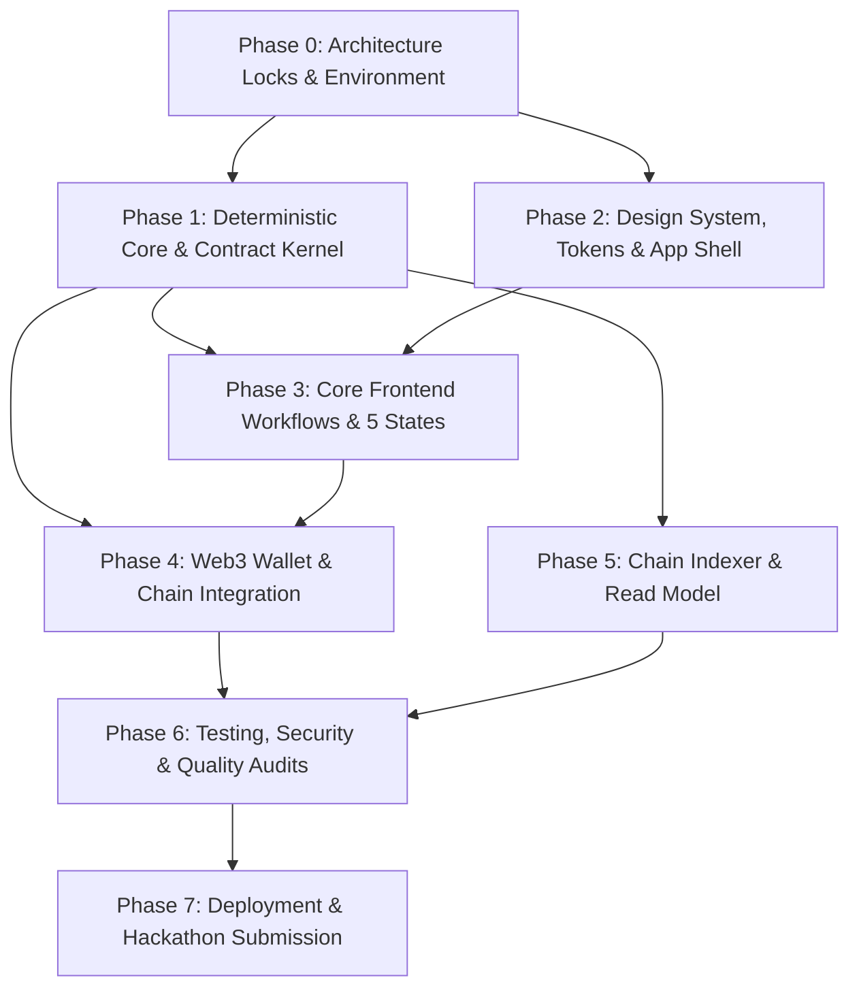

# Netteo — Project Roadmap & Sequential Phases

**Project:** Netteo (Multilateral Obligation Netting and MUSD Settlement on Mezo)  
**Status:** Living Roadmap  
**Version:** 1.0  
**Last Updated:** 20 October 2026  

---

## Roadmap Overview & Operating Philosophy

Netteo is built following a strict execution sequence:
> **Foundations & Architecture Locks → Deterministic Core Logic → Smart Contract Kernel → Design System & App Shell → Frontend Workflows (5 States) → Web3 & Indexer Integration → Audits & Verification → Deployment & Submission.**

No phase may be marked complete without meeting its measurable completion criteria. Any task marked blocked halts dependent downstream phases.

---

## Phase 0: Architecture Locks & Foundations (Current State)

- **Objective:** Finalize open architecture and security decisions identified in `PrD.md` §14, verify Mezo testnet parameters, and establish local project structure.
- **Dependencies:** None.
- **Deliverables:**
  - Resolved Decision Matrix (Storage model, confirmation policy, timeout rules, caps).
  - Verified Mezo testnet parameters (Chain ID 31611, RPC URL, explorer URL, MUSD token address & decimals).
  - Directory skeleton matching `architecture.md` §7.
- **Tasks:**
  - [x] Unpack and verify Roundo font files in `public/fonts/`.
  - [x] Configure TypeScript (`tsconfig.json`) and Next.js base config (`next.config.mjs`).
  - [ ] Lock ADR on Obligation Storage Model: On-chain records vs. Canonical commitment snapshot.
  - [ ] Lock Cycle Confirmation Policy: Required signers before funding begins.
  - [ ] Lock Cycle Timeout & Refund Period duration (e.g., 72-hour funding window).
  - [ ] Set participant (max 10) and obligation (max 30) limits per cycle for gas bounding.
  - [ ] Verify Mezo testnet RPC, MUSD token contract address, and explorer URL.
- **Blockers & Prerequisites:**
  - Cannot write smart contracts until storage model and confirmation policy are locked.
- **Measurable Completion Criteria:**
  - Decision log documented in `memory.md`.
  - Environment variable schema defined in `.env.example`.

---

## Phase 1: Deterministic Core & Contract Kernel

- **Objective:** Build and test the pure TypeScript reference netting algorithm and implement the Solidity `SettlementKernel` contract.
- **Dependencies:** Phase 0 completion.
- **Deliverables:**
  - `src/features/settlement-cycles/netting.ts` (pure deterministic netting function).
  - Comprehensive unit test suite for netting logic (zero-sum, edge cases, cycle invariance).
  - `contracts/SettlementKernel.sol` (or Foundry workspace) enforcing atomic collect-then-distribute and refunds.
  - Foundry/Hardhat contract test suite covering deposits, distribution, timeouts, reentrancy, and failure modes.
- **Tasks:**
  - [ ] Implement `netting.ts` reference calculation using integer token base units (no floating-point math).
  - [ ] Write exhaustive unit tests for `netting.ts` (2–10 participants, zero-net positions, circular debts).
  - [ ] Implement `SettlementKernel.sol` with SafeERC20, ReentrancyGuard, and explicit cycle state machine.
  - [ ] Implement atomic distribution (`executeSettlement`) and timeout refund (`claimRefund`).
  - [ ] Write contract test suite for happy path, double distribution prevention, and edge cases.
- **Blockers & Prerequisites:**
  - Frontend wallet integration cannot proceed without verified contract ABI and bytecode.
- **Measurable Completion Criteria:**
  - 100% test pass on netting invariants: $\sum \text{net positions} = 0$, $\sum \text{debits} = \sum \text{credits}$.
  - Contract test suite passes all revert and timeout scenarios.

---

## Phase 2: Design System, Tokens & App Shell

- **Objective:** Establish the Netteo "warm minimal fintech" visual foundation, custom icons, typography, and accessible application shell.
- **Dependencies:** Phase 0 completion.
- **Deliverables:**
  - `src/styles/tokens.css` with exact palette (Wine `#7F011F`, Sand `#F5EBD0`, Ink `#211A1B`, Page `#F9F6EF`, Border `#E5DCCF`).
  - Font loader configuration for local Roundo font family in `src/app/layout.tsx`.
  - Icon wrapper `<Icon />` enforcing `--icon-stroke: 1.75px` across Lucide and custom SVGs.
  - Bespoke Netteo SVG icons (Obligation, Netting, Cycle, Snapshot, Position balance).
  - Responsive app shell (`<AppHeader />`, `<AppNav />`, `<WalletIndicator />`) with single navigation model.
- **Tasks:**
  - [ ] Create tokenized CSS system in `src/styles/tokens.css` and `globals.css`.
  - [ ] Configure `next/font/local` for Roundo weights (Regular, Medium, SemiBold, Bold).
  - [ ] Build `<Button />` component implementing Netteo button spec (Primary, Secondary, Tertiary, Destructive, loading width-locked, double-click protection).
  - [ ] Build `<Icon />` component and custom SVGs in `src/components/icons/netteo/`.
  - [ ] Implement responsive shell with desktop and mobile layouts (no duplicate navigation).
- **Blockers & Prerequisites:**
  - UI screens cannot be constructed without the verified token, button, and icon primitives.
- **Measurable Completion Criteria:**
  - Visual verification of Roundo font rendering in browser.
  - Design-addendum §7 button and §8 motion tokens applied and verified.
  - Zero un-tokenized hex codes or ad-hoc style classes.

---

## Phase 3: Core Frontend Workflows & 5 Screen States

- **Objective:** Implement all four primary product workflows with mandatory 5-state handling (Loading, Empty, Error, Success, Offline) and double-click protection.
- **Dependencies:** Phase 1 (`netting.ts`) and Phase 2 (Design System & Shell).
- **Deliverables:**
  - Group Management view (`/groups`).
  - Obligation Desk ledger (`/obligations`) for proposing, accepting, disputing, and withdrawing claims.
  - Settlement Cycle Assembly & Preview (`/cycles/new` and `/cycles/[id]`) with signature gross-to-net graph.
  - Funding & Execution Desk (`/cycles/[id]/fund`).
  - Settlement Statement & Audit View (`/cycles/[id]/audit`).
- **Tasks:**
  - [ ] Build Group creation and membership invitation views.
  - [ ] Build Obligation Desk as an auditable financial ledger (tabular numbers, explicit debtor/creditor).
  - [ ] Build Obligation proposal form with inline validation, character count, and input preservation on error.
  - [ ] Build Cycle Preview screen displaying gross obligations and computed net positions side-by-side.
  - [ ] Implement signature Netting Transition (gross edges collapsing into net allocation, 240ms, reduced-motion safe).
  - [ ] Build Debtor Deposit interface with MUSD allowance check and exact amount input.
  - [ ] Implement the mandatory 5 screen states for every view (Loading <200ms, Empty with CTA, Error with recovery, Success confirmation, Offline detection).
  - [ ] Implement double-click protection on all mutation and transaction buttons.
- **Blockers & Prerequisites:**
  - Cycle assembly requires `netting.ts` logic to compute previews correctly.
- **Measurable Completion Criteria:**
  - Every screen passes the 5-state inventory check (`Prototype_vs_Production_Checklist` §4).
  - No form discards user input upon validation or submission failure.
  - All financial tables use tabular figures and clear decimal formatting.

---

## Phase 4: Web3 Wallet & On-Chain Integration

- **Objective:** Connect browser wallets via Viem/Wagmi to Mezo testnet and execute live MUSD settlements against `SettlementKernel`.
- **Dependencies:** Phase 1 (Contracts) and Phase 3 (Frontend Workflows).
- **Deliverables:**
  - Typed chain configuration module (`src/lib/chain/config.ts`).
  - Wagmi/Viem provider setup with Mezo testnet network definition.
  - Contract write hooks for `approve`, `deposit`, `executeSettlement`, and `claimRefund`.
  - Transaction lifecycle feedback component (`<TransactionStatus />`) showing submitted, pending, confirmed, and reverted states.
- **Tasks:**
  - [ ] Configure Wagmi with Mezo testnet (Chain ID 31611, RPC, MUSD address).
  - [ ] Implement wallet connection modal and account badge with checksummed address display.
  - [ ] Implement wrong-network banner with one-click "Switch to Mezo Testnet" action.
  - [ ] Wire MUSD token `approve` and `allowance` verification before deposit.
  - [ ] Wire `SettlementKernel.deposit` with exact required net debtor balance.
  - [ ] Wire `executeSettlement` atomic trigger once all debtors have funded.
  - [ ] Link confirmed transaction hashes to the Mezo testnet block explorer.
- **Blockers & Prerequisites:**
  - Requires deployed `SettlementKernel` contract on Mezo testnet or local fork.
- **Measurable Completion Criteria:**
  - Live wallet can connect, switch network, approve MUSD, deposit, and execute settlement.
  - UI waits for on-chain receipt confirmation before displaying success.

---

## Phase 5: Chain Indexer & Read Model (Supabase / Postgres)

- **Objective:** Implement the off-chain query layer and event indexer to maintain queryable projections of cycle history without compromising on-chain truth.
- **Dependencies:** Phase 1 (Contract Events) and Phase 4 (Chain Config).
- **Deliverables:**
  - Postgres database schema with RLS policies (`src/lib/db/schema.sql`).
  - Idempotent event processing worker (`src/lib/indexer/worker.ts`).
  - CSV settlement statement generator (`src/features/audit/csv-export.ts`).
- **Tasks:**
  - [ ] Set up Supabase tables (`groups`, `obligations`, `cycles`, `indexed_events`, `projections`).
  - [ ] Write and verify strict Row Level Security (RLS) policies for group access.
  - [ ] Build idempotent event ingestion filtering by `(chain_id, tx_hash, log_index)`.
  - [ ] Build indexer cursor and freshness indicator in the UI.
  - [ ] Implement CSV export for completed cycle reconciliation.
- **Blockers & Prerequisites:**
  - Database schema must strictly treat chain events as authoritative over metadata.
- **Measurable Completion Criteria:**
  - Indexer can replay logs from start block and reconstruct cycle projections identically.
  - Supabase anon key exposed safely; zero service-role keys in client bundles.

---

## Phase 6: Testing, Security & Quality Audits

- **Objective:** Execute comprehensive frontend, smart contract, accessibility, and security reviews before final deployment.
- **Dependencies:** Phases 1 through 5 complete.
- **Deliverables:**
  - Security audit report matching `Secure_Vibe_Coding.pdf` and `Security_Prompt_Pack_Freebie (2).pdf`.
  - UI review report matching `design-addendum.md` §19 and Codex Appendix B.
  - Multi-viewport verification record across 320px, 390px, 768px, 1024px, and 1440px.
- **Tasks:**
  - [ ] Run full test suite (unit tests, integration tests, contract tests).
  - [ ] Conduct Error Safety Audit: verify zero stack traces or DB schema leaked in UI or console.
  - [ ] Conduct IDOR & Route Tampering Review: verify URL params cannot access unauthorized group cycles.
  - [ ] Run 30-item Slop Audit (Codex Appendix B): verify no unapproved gradients, no generic card grids, consistent typography.
  - [ ] Perform Keyboard Navigation & Tab-only walkthrough with visible focus rings.
  - [ ] Test slow network (Slow 3G) and offline simulation.
- **Blockers & Prerequisites:**
  - All critical security and slop audit findings must be resolved before Phase 7.
- **Measurable Completion Criteria:**
  - Zero critical security vulnerabilities (no leaked secrets, no IDOR, safe errors).
  - All 5 screen states verified across all views.
  - 100% TypeScript typecheck and production build passing (`next build`).

---

## Phase 7: Deployment, Verification & Hackathon Submission

- **Objective:** Deploy production application, publish verified smart contracts on Mezo, record proof-of-settlement demo, and package submission materials.
- **Dependencies:** Phase 6 sign-off.
- **Deliverables:**
  - Deployed, working production web application on Vercel.
  - Verified `SettlementKernel` contract on Mezo testnet explorer.
  - End-to-end demo video recording showing a real completed MUSD settlement cycle.
  - Complete project README with contract addresses, verified tx hashes, architecture breakdown, and disclosed limitations.
- **Tasks:**
  - [ ] Deploy frontend to Vercel with verified production environment variables.
  - [ ] Deploy and verify `SettlementKernel` on Mezo testnet.
  - [ ] Execute canonical 3-participant testnet cycle (A owes B 100, B owes C 80, C owes A 20) with real testnet MUSD.
  - [ ] Document transaction hashes and block explorer links in README.
  - [ ] Record crisp demo walkthrough highlighting the signature netting transition and on-chain proof.
  - [ ] Final submission verification checklist.
- **Blockers & Prerequisites:**
  - Live testnet MUSD funding required for the recorded demonstration.
- **Measurable Completion Criteria:**
  - Public web application URL loads cleanly in a fresh incognito browser session.
  - Explorer links confirm real MUSD token transfers matching the mathematical net positions.
